# BLUEPRINT_PAGOS.md — Pagos seguros con Stripe, en tres versiones

> Blueprint de diseño autosuficiente: arquitectura, diseño de bajo nivel (LLD), base de datos, API, configuración de
> Stripe y seguridad. Es la entrada de las guías prácticas de pagos (ver la sección 0.2). Una sesión futura debería
> poder escribir cada guía leyendo **solo** este archivo y verificando las fuentes de la sección 10.
>
> Lo que cambia (qué guía está hecha) va en `PROGRESO.md`; las reglas estables de las guías están en `CLAUDE.md`
> ("De las guías de proyectos"): Claude escribe las guías, no las ejecuta, y nunca inventa salidas ni cifras.
>
> **Fecha de verificación de datos de Stripe y PostgreSQL:** 2026-10-10.

---

## 0. Qué hay aquí y cómo se usa

### 0.1 Las tres versiones

| Versión | Qué se vende | Problema central | Mecanismo |
|---|---|---|---|
| **V1** | Un producto sin inventario limitado (un curso, una licencia digital) | Cobrar una sola vez aunque el cliente haga doble clic, la red falle o Stripe reintente | Idempotency key del cliente, orden con máquina de estados, Stripe Checkout hospedado, webhook firmado y reembolso pedido por el cliente |
| **V2** | 100 boletos de una función de cine, con asiento | No vender un asiento dos veces, con etapas que vencen: reserva de 30 s y checkout de 3 min | Locks pesimistas de fila (`SELECT … FOR UPDATE NOWAIT`) + hold lógico con vencimiento + barrido que cancela el PaymentIntent antes de liberar + una prórroga única si el banco está pidiendo 3D Secure |
| **V3** | Lo mismo que V2 | Lo mismo, pero que la base garantice la regla sola y que nunca haga falta reembolsar por tiempo | Claims temporales con **exclusion constraint** (`EXCLUDE USING gist`) + **autorizar y capturar** (`capture_method=manual`) |

V1 es la base: todo lo que define (idempotencia, webhooks, claves de Stripe, seguridad) lo reutilizan V2 y V3 sin repetirlo.

### 0.2 Cómo entra en el curso (decidido el 2026-10-10)

Tres guías separadas, una tras otra en la ruta de proyectos (bloque 4, justo después de A14):

| Guía | Versión | Título | Excusa |
|---|---|---|---|
| **A15** | V1 | Idempotencia de punta a punta | Un botón de pagar |
| **A27** | V2 | Cien asientos con locks pesimistas | La taquilla de un cine, con reserva de 30 s y checkout de 3 min |
| **A28** | V3 | Cien asientos con la base como árbitro | La misma taquilla, sin barrido obligatorio y sin reembolsos por tiempo |

- **A15** ya estaba en `projects.data.js` con la excusa "Un botón de pagar" y promete la tabla de claves con huella del body (422 si cambia, 409 si sigue en curso), repetir la respuesta, vencer las claves a las 24 h y por qué un advisory lock de sesión no sirve detrás de PgBouncer en modo transacción. V1 cumple todo eso y le suma Stripe y los reembolsos.
- **A27 y A28** tienen números nuevos porque A16–A26 ya están tomados, pero en la ruta van inmediatamente después de A15, en ese orden. Renumerar A16–A26 rompería las referencias de `proyectos.html` y de `PROGRESO.md`.
- **Cada guía funciona sola** (regla de `CLAUDE.md`): A27 trae completos los archivos de idempotencia y webhooks aunque A15 ya los tenga, y A28 trae completos los de A27 que no cambian. "Cómo conectar" de A27 nombra a A15; el de A28 nombra a A15 y A27, y explica qué archivo de A27 reemplaza cada pieza.
- **C1 "Pagos distribuidos"** retoma V1 y le suma el ledger de doble entrada, la conciliación y las réplicas. El ledger no entra aquí porque el pedido es una base mínima.

### 0.3 Encaje con módulos publicados (enlaces que la guía usa en "Cómo conectar")

| Tema | Dónde se explica |
|---|---|
| Dinero en enteros y moneda | `m27-pagos-stripe.html#dinero` |
| Máquina de estados del PaymentIntent | `m27-pagos-stripe.html#paymentintent` |
| Idempotency keys de principio a fin | `m27-pagos-stripe.html#idempotencia`, `m02-apis.html#idempotencia` |
| Webhooks del lado del comercio | `m27-pagos-stripe.html#webhooks`, `m02-apis.html#webhooks` |
| Sagas y compensación | `m27-pagos-stripe.html#sagas`, `m05-bases-de-datos.html#sagas` |
| PCI DSS, tokenización, card testing | `m27-pagos-stripe.html#pci`, `m27-pagos-stripe.html#card-testing` |
| Locks y MVCC, niveles de aislamiento | `m05-bases-de-datos.html#tx-mvcc`, `m05-bases-de-datos.html#tx-niveles` |
| Roles, GRANT y mínimo privilegio | `m05-bases-de-datos.html#roles-grant` |
| Rate limiting | `m08-resiliencia.html#rate-limiting` |
| CSRF y sesiones | `m10-seguridad.html#xss-csrf-detalle` |
| SSE: formato, cliente, infraestructura y reanudar | `m17-api-streaming.html#sse-formato`, `#sse-cliente`, `#sse-infra`, `#reanudar` |

---

## 1. Invariantes: lo que el sistema nunca puede violar

Todo el diseño existe para sostener estas reglas. Las pruebas de la sección 8 las comprueban con SQL.

1. **Un cobro por intención de compra.** Una misma acción del usuario (mismo `Idempotency-Key`) produce como máximo una orden y un PaymentIntent, aunque llegue diez veces.
2. **Ningún asiento vendido dos veces.** En cada función, cada asiento tiene como máximo un boleto válido.
3. **Ningún boleto sin dinero.** Un boleto existe solo si su pago está `succeeded` (V2) o capturado (V3).
4. **Ningún dinero sin boleto o sin devolución.** Si Stripe cobró o retuvo dinero y el asiento no se pudo entregar, el sistema lo devuelve (V2: refund) o libera la retención (V3: cancel) sin intervención humana.
5. **El monto lo decide el servidor.** El cliente nunca envía precios; el monto sale de la base y se compara con el que Stripe reporta antes de entregar.
6. **Un solo reloj.** Los vencimientos se calculan con el reloj de PostgreSQL (`now()`), nunca con el de la aplicación ni el del navegador.
7. **La tarjeta nunca toca nuestros servidores.** El número de tarjeta viaja del navegador a Stripe; nosotros solo vemos ids (`pi_…`, `cs_…`).

---

## 2. Decisiones transversales (valen para las tres versiones)

### 2.1 Stack y versiones

| Pieza | Versión | Nota |
|---|---|---|
| Java | 25 | Igual que A00–A10 |
| Spring Boot | 4.1.1 | Igual que A09 |
| PostgreSQL | 18 | `uuidv7()` nativo; temporal constraints `WITHOUT OVERLAPS` (V3, ver 6.2) |
| PgBouncer | `edoburu/pgbouncer:v1.26.0-p0`, `POOL_MODE: transaction` | Igual que A09. En modo transacción no hay advisory locks de sesión ni `LISTEN` |
| Redis | 8.10 | Solo V2/V3: rate limiting y Pub/Sub del mapa en vivo por SSE (5.15) |
| stripe-java | 34.0.0 (estable, 2026-10-01) | Verificar al escribir la guía que fija `2026-09-30.endive`. En Java la versión de la API la fija el SDK y no se cambia por request *(Documentado)* |
| Stripe API | `2026-09-30.endive` | La última que muestra `docs.stripe.com/upgrades` el 2026-10-10 |
| Stripe.js | `https://js.stripe.com/…` | Se carga siempre desde js.stripe.com, nunca se empaqueta ni se sirve desde un CDN propio |
| Stripe CLI | ≥ 1.43.3 | Para `stripe listen` y `stripe trigger` |

Acceso a datos con `JdbcClient` de Spring y SQL explícito, no JPA: aquí el SQL exacto es el diseño (locks, `RETURNING`, códigos de error), y un ORM lo esconde.

### 2.2 Arquitectura común

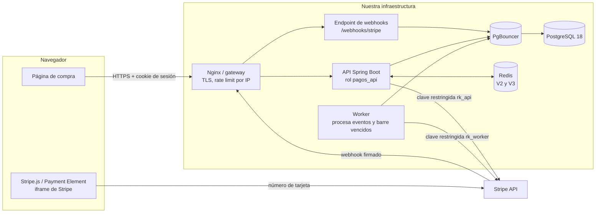

- **API, webhook y worker son la misma imagen con tres perfiles de Spring** (`api`, `webhook`, `worker`), como la imagen de dos perfiles de A09. Cada perfil recibe solo la clave de Stripe y el rol de base que necesita.
- **El webhook solo guarda y responde.** Verifica la firma, inserta el evento en la tabla `stripe_events` (inbox) y responde 200. El worker procesa la inbox. Así una base lenta no hace que Stripe vea timeouts y reintente.
- **Ninguna transacción de base queda abierta durante una llamada a Stripe.** Cada endpoint que habla con Stripe se parte en fases atómicas (sección 2.4).

### 2.3 Configuración de Stripe paso a paso

Esto lo hace el lector en el Dashboard o con la CLI; la guía lo lista en este orden.

1. **Cuenta y sandbox.** Crear la cuenta, activar la verificación en dos pasos y trabajar en un sandbox. Las claves de prueba empiezan con `sk_test_`, `rk_test_` y `pk_test_`.
2. **Versión de la API.** stripe-java fija la suya; el destino de webhooks de tipo snapshot se crea con la **misma** versión (`snapshot_api_version` solo se elige al crear el destino) *(Documentado)*.
3. **Claves restringidas, una por servicio** (`rk_…`, permisos por recurso: None, Read o Write; Write incluye Read) *(Documentado)*. Nunca se usa la `sk_` en la aplicación.

   | Clave | Servicio | Permisos | Versión |
   |---|---|---|---|
   | `rk_api` | perfil `api` | Checkout Sessions: Write (V1); PaymentIntents: Write (V2, V3: crear, leer y cancelar); Refunds: None (los reembolsos de V1 los hace el worker, 4.6); todo lo demás: None | V1–V3 |
   | `rk_worker` | perfil `worker` | PaymentIntents: Write (leer, cancelar, capturar); Refunds: Write; Checkout Sessions: Read (V1); Events: Read | V1–V3 |
   | (ninguna) | perfil `webhook` | No recibe clave de API: solo verifica firmas con el `whsec_` | V1–V3 |
   | `pk_` | navegador | Clave publicable, pública por diseño | V2, V3 |

4. **Secretos.** `STRIPE_API_KEY`, `STRIPE_WEBHOOK_SECRET` y `STRIPE_PUBLISHABLE_KEY` entran por variables de entorno desde un `.env` que no se versiona (en k3s, un `Secret`). Nada de claves en `application.yaml` ni en el repositorio.
5. **Métodos de pago.** V1: los que ofrezca el Dashboard por defecto (Checkout los elige solo). V2 y V3: **solo tarjeta** (`payment_method_types=["card"]`), porque los métodos con notificación diferida (transferencias, vouchers) tardan horas o días y no caben en un checkout de 3 min. Apple Pay y Google Pay en el Payment Element necesitan registrar el dominio en *Payment method domains*.
6. **Datos del comercio.** Nombre público, `statement descriptor` (lo que ve el cliente en su estado de cuenta) y correo de soporte. Los recibos de Stripe por correo se pueden activar en *Customer emails*.
7. **Radar.** Dejar activas las reglas por defecto. Es la segunda línea contra card testing; la primera es nuestra (sección 2.6).
8. **Destino de webhooks** en Workbench → Webhooks: payload *Snapshot*, la versión del SDK, URL `https://<dominio>/webhooks/stripe` y **solo** estos eventos:

   | Versión | Eventos |
   |---|---|
   | V1 | `checkout.session.completed`, `checkout.session.async_payment_succeeded`, `checkout.session.async_payment_failed`, `checkout.session.expired`, `charge.refunded`, `refund.updated`, `refund.failed`, `charge.dispute.created` |
   | V2 | `payment_intent.succeeded`, `payment_intent.payment_failed`, `payment_intent.canceled`, `charge.refunded`, `charge.dispute.created` |
   | V3 | Los de V2 + `payment_intent.amount_capturable_updated` |

   Se elige snapshot y no thin porque los eventos thin para recursos v1 todavía aparecen como vista previa privada en la página de upgrades *(Documentado)*. Igual se trata el snapshot como aviso: el worker siempre vuelve a leer el objeto de la API antes de actuar (2.5).

9. **Local.** `stripe login` y después:

   ```bash
   # V1 (A15)
   stripe listen --forward-to localhost:8080/webhooks/stripe \
     --events checkout.session.completed,checkout.session.async_payment_succeeded,checkout.session.async_payment_failed,checkout.session.expired,charge.refunded,refund.updated,refund.failed
   # V2 (A27); V3 (A28) suma payment_intent.amount_capturable_updated
   stripe listen --forward-to localhost:8080/webhooks/stripe \
     --events payment_intent.succeeded,payment_intent.payment_failed,payment_intent.canceled,charge.refunded
   ```

   La CLI imprime un `whsec_…` distinto del del Dashboard; no se mezclan *(Documentado)*.

10. **Tarjetas de prueba** *(Documentado)*: `4242 4242 4242 4242` (aprobada), `4000 0025 0000 3155` (pide 3D Secure en pagos con el cliente presente), `4000 0027 6000 3184` (pide 3D Secure siempre: la de la prueba de la prórroga), `4000 0000 0000 9995` (rechazada por fondos insuficientes), `4000 0000 0000 0002` (rechazo genérico), `4000 0000 0000 7726` (el reembolso empieza `pending` y después pasa a `succeeded` con `refund.updated`), `4000 0000 0000 5126` (el reembolso empieza `succeeded` y después falla con `refund.failed`).

### 2.4 Protocolo de idempotencia (común)

**Contrato HTTP.** Todo `POST` que cambia estado exige `Idempotency-Key: <UUIDv4>`. La genera el navegador **al abrir la intención** (al pulsar "Pagar" o "Reservar"), la guarda en memoria y la reutiliza en cada reintento de esa misma acción. Una acción nueva lleva una clave nueva.

| Situación | Respuesta |
|---|---|
| Falta el header o no es un UUID | `400 IDEMPOTENCY_KEY_REQUIRED` |
| Clave nueva | Se ejecuta normalmente |
| Clave conocida, mismo body, terminada | Se repite el status y el body guardados, con `Idempotent-Replayed: true` |
| Clave conocida, body distinto | `422 IDEMPOTENCY_KEY_REUSED` |
| Clave conocida, otra request la está ejecutando | `409 IDEMPOTENCY_IN_PROGRESS` con `Retry-After: 1` |
| Clave conocida, quedó a medias (el proceso murió) | Se retoma desde la última fase confirmada |

**Alcance de la clave:** por usuario (`PRIMARY KEY (user_id, idem_key)`). Dos usuarios con el mismo UUID no chocan, y nadie puede leer la respuesta guardada de otro.

**Huella del body:** SHA-256 del JSON canónico (Jackson con `ORDER_MAP_ENTRIES_BY_KEYS` y `SORT_PROPERTIES_ALPHABETICALLY`; las listas con semántica de conjunto, como los asientos, se ordenan antes). Se guarda también el método y la ruta: la misma clave en otro endpoint es `422`.

**Fases atómicas.** Un endpoint que llama a Stripe no puede estar en una sola transacción. Se parte en fases, cada una con su commit, y la fila de la clave guarda la última fase confirmada (`recovery_point`). Es el diseño de *idempotency keys* con fases atómicas que publicó Brandur Leach, ingeniero de Stripe *(Diseño de referencia)*.

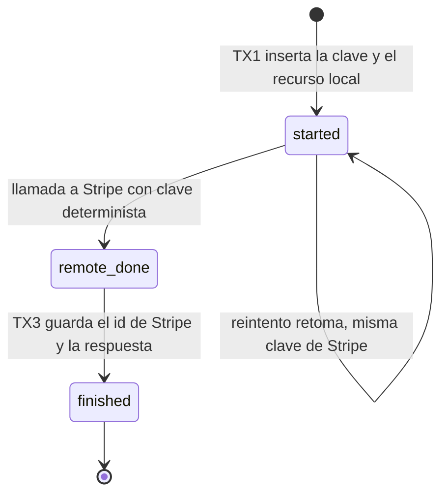

- **Exclusión entre requests con la misma clave:** columna `locked_until`. Tomar la clave es `UPDATE … SET locked_until = now() + interval '30 seconds' WHERE … AND (locked_until IS NULL OR locked_until < now()) RETURNING …`. Si no devuelve fila, otra request la tiene: `409`. Si el proceso muere, el lease vence solo y el siguiente reintento retoma. **No se usa `pg_advisory_lock`**: es de sesión y PgBouncer en modo transacción reparte la sesión entre clientes (lo que A15 promete explicar).
- **Claves deterministas hacia Stripe**, derivadas de nuestros ids: `cs-create:{order_id}`, `pi-create:{reservation_id}`, `pi-cancel:{pi_id}`, `pi-capture:{pi_id}`, `refund:{pi_id}`. Un reintento nuestro reusa el mismo objeto de Stripe. Stripe compara los parámetros con los de la primera request y da error si cambian *(Documentado)*; por eso **todo parámetro que dependa del tiempo se calcula una vez y se guarda** (por ejemplo `checkout_expires_at` en V1). Stripe guarda la respuesta desde que la ejecución empieza, incluidos los `500`; si la validación falla o hay una request concurrente con la misma clave, no guarda nada y se puede reintentar *(Documentado)*. Las claves de Stripe viven al menos 24 h y miden hasta 255 caracteres *(Documentado)*.
- **Qué se guarda:** solo las respuestas de requests que cambiaron estado. Un `409 SEAT_UNAVAILABLE` no tiene efectos, así que no se guarda: el reintento con la misma clave se evalúa de nuevo y puede salir bien si el asiento se liberó. Es una diferencia deliberada con Stripe, que guarda también los errores.
- **Datos sensibles:** el `client_secret` del PaymentIntent no se guarda en `response_body`. Al repetir una respuesta, el servidor lo vuelve a leer de Stripe (`PaymentIntent.retrieve`) y lo inserta.
- **Vencimiento:** un job con el rol `pagos_jobs` borra claves con más de 24 h, en lotes de 1 000.

```sql
CREATE TABLE idempotency_keys (
  user_id        bigint      NOT NULL,
  idem_key       uuid        NOT NULL,
  method_path    text        NOT NULL,                 -- 'POST /v1/orders'
  request_hash   bytea       NOT NULL,                 -- SHA-256 del body canónico (32 bytes)
  recovery_point text        NOT NULL DEFAULT 'started'
                 CHECK (recovery_point IN ('started', 'remote_done', 'finished')),
  locked_until   timestamptz,
  resource_id    uuid,                                 -- la orden o la reserva que creó
  response_status smallint,
  response_body  jsonb,                                -- sin client_secret
  created_at     timestamptz NOT NULL DEFAULT now(),
  PRIMARY KEY (user_id, idem_key),
  CHECK (octet_length(request_hash) = 32),
  CHECK ((recovery_point = 'finished') = (response_status IS NOT NULL))
);
CREATE INDEX idempotency_keys_created ON idempotency_keys (created_at);
```

### 2.5 Protocolo de webhooks (común)

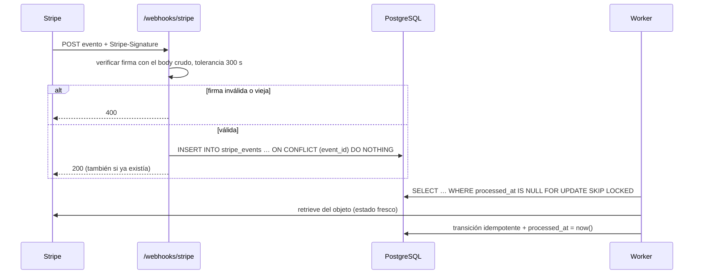

- **Firma.** `Stripe-Signature: t=<unix>,v1=<hex>`; `v1` es HMAC-SHA256 con el `whsec_` como clave sobre `"{t}.{body crudo}"`. Se ignoran los esquemas que no son `v1`, se compara en tiempo constante y se rechaza un `t` con más de 300 s de diferencia (la tolerancia por defecto de las librerías, nunca 0) *(Documentado)*. Se usa `Webhook.constructEvent(payload, header, secret)` de stripe-java, que hace todo eso.
- **Body crudo.** El controlador recibe `@RequestBody byte[]` y lo convierte a `String` en UTF-8. Ningún filtro puede leer ni reformatear el body antes (cualquier cambio rompe la firma) *(Documentado)*.
- **Fuera de CSRF y de la sesión**, pero con su propia autenticación (la firma): `csrf.ignoringRequestMatchers("/webhooks/stripe")` y `permitAll()` solo para esa ruta. Opcional: lista de IPs de Stripe en Nginx *(Documentado)*.
- **Duplicados y orden.** Stripe puede entregar un evento más de una vez y no garantiza el orden *(Documentado)*. La dedup es por `event_id` (clave primaria). El orden no importa porque el worker no aplica el evento: vuelve a leer el objeto de la API y aplica una transición de estado que solo avanza (`UPDATE … WHERE status = 'esperado'`).
- **Reintentos de Stripe.** En modo live, hasta tres días con backoff exponencial; en sandbox, tres veces en unas horas *(Documentado)*. El worker además reintenta los eventos que fallaron (`attempts`, `last_error`) y alerta a los 10 intentos.
- **Respaldo si el webhook no llega:** el barrido periódico (V2, V3) y la página de éxito (V1) consultan el objeto en Stripe. El webhook no es el único camino a la verdad.

```sql
CREATE TABLE stripe_events (
  event_id     text        PRIMARY KEY,               -- evt_…
  type         text        NOT NULL,
  object_id    text        NOT NULL,                  -- pi_…, cs_…, ch_…
  livemode     boolean     NOT NULL,
  payload      jsonb       NOT NULL,                  -- para auditoría; no se confía en él para actuar
  received_at  timestamptz NOT NULL DEFAULT now(),
  processed_at timestamptz,
  attempts     integer     NOT NULL DEFAULT 0,
  last_error   text
);
CREATE INDEX stripe_events_pending ON stripe_events (received_at) WHERE processed_at IS NULL;
```

El worker rechaza (y alerta) un evento con `livemode = true` en un entorno de prueba, y al revés.

### 2.6 Seguridad

| Amenaza | Defensa | Dónde |
|---|---|---|
| Robo de datos de tarjeta | El número va del navegador a Stripe. V1 usa Checkout hospedado (la página de pago es de Stripe, el menor alcance de PCI). V2 y V3 usan el Payment Element (iframe de Stripe), pero la página que lo contiene es nuestra: CSP estricta (`script-src 'self' https://js.stripe.com`, `frame-src https://js.stripe.com https://hooks.stripe.com`, `connect-src 'self' https://api.stripe.com`), sin scripts de terceros en la página de pago. Verificar la elegibilidad de SAQ en la guía de seguridad de Stripe | Front |
| Precio manipulado | El cliente envía `product_id` y `quantity`, o asientos; nunca montos. El monto se calcula en el servidor y se compara con `pi.amount` y `pi.currency` antes de entregar | API, worker |
| Webhook falso | Firma HMAC + tolerancia + dedup; el worker vuelve a leer de Stripe con una clave propia, así que un evento falso con firma válida (imposible sin el `whsec_`) igual no podría inventar un pago | Webhook |
| IDOR: pagar o ver la reserva de otro | Toda consulta lleva `AND user_id = :usuarioActual`; si no es tuya, `404` (no `403`, para no confirmar que existe) | API |
| Acaparar asientos con bots | Login obligatorio; máximo 10 asientos por reserva; una reserva activa por usuario y función (índice único parcial); rate limit de `POST /reservations` (10 por minuto por usuario, token bucket en Redis); el hold de 30 s hace caro mantener asientos tomados | API, Redis |
| Card testing | Para llegar a un PaymentIntent hace falta cuenta y reserva activa; rate limit de checkout (5 por 10 min por usuario); Radar con las reglas por defecto | API, Stripe |
| Claves filtradas | Claves restringidas por servicio, en variables de entorno; rotación con expiración diferida; el `whsec_` se rota con un día de solapamiento (Stripe firma con los dos mientras tanto) | Operación |
| Base comprometida por la app | Roles con mínimo privilegio (abajo); la app no tiene `DELETE` ni `TRUNCATE` en tablas de dinero | PostgreSQL |
| Logs con datos sensibles | Se loguean ids (`pi_…`, `evt_…`, `reservation_id`), nunca `client_secret`, correos ni cuerpos de Stripe completos | Todos |
| Reloj adelantado del cliente | El servidor devuelve `expires_at` y `server_time`; el navegador calcula su desfase y dibuja la cuenta regresiva con él. El vencimiento real lo decide `now()` de PostgreSQL | API |

Roles de base (se retoman en V2 y V3 agregando sus tablas):

```sql
CREATE ROLE pagos_api     LOGIN;  -- contraseña por Secret, no en el repositorio
CREATE ROLE pagos_webhook LOGIN;
CREATE ROLE pagos_worker  LOGIN;
CREATE ROLE pagos_jobs    LOGIN;

GRANT SELECT                 ON products                     TO pagos_api, pagos_worker;
GRANT SELECT, INSERT, UPDATE ON orders, idempotency_keys     TO pagos_api;
GRANT SELECT, UPDATE         ON orders                       TO pagos_worker;
GRANT INSERT                 ON stripe_events                TO pagos_webhook;  -- solo insertar
GRANT SELECT, UPDATE         ON stripe_events                TO pagos_worker;
GRANT DELETE                 ON idempotency_keys             TO pagos_jobs;     -- único DELETE del sistema
GRANT SELECT                 ON idempotency_keys             TO pagos_jobs;
```

El webhook inserta con `ON CONFLICT DO NOTHING`, que solo necesita `INSERT`. Ningún rol de la aplicación es dueño de las tablas (el dueño se salta los permisos; ver M05).

### 2.7 Dinero

- Montos en la unidad menor de la moneda (`integer`, centavos), con la moneda al lado en minúsculas (`usd`), como en M27 27.3. Nunca `float` ni `numeric` con decimales en el dominio.
- En Java, un `record Money(long minor, String currency)` con suma que falla si las monedas difieren.
- El precio se congela en la orden o la reserva al crearla; si el catálogo cambia después, la orden conserva su monto.
- **Moneda: USD en las tres guías** (decidido el 2026-10-10). La base lo fija con `CHECK (currency = 'usd')`; abrir otra moneda es una migración, no un parámetro. Stripe exige un cobro mínimo de 0.50 USD *(Documentado)*, así que los precios llevan `CHECK (price_minor >= 50)`; un precio menor fallaría en Stripe con `amount_too_small` después de haber creado la orden.

---

## 3. Errores de la API (formato común)

```json
{
  "error": {
    "code": "SEAT_UNAVAILABLE",
    "message": "Uno o más asientos no están disponibles.",
    "details": { "unavailable": [ { "seat": "F8", "status": "held", "held_until": "2026-10-10T19:04:31.120Z" } ] },
    "request_id": "01JA3…"
  }
}
```

| Código | HTTP | Cuándo |
|---|---|---|
| `VALIDATION_FAILED` | 400 | Body inválido, asiento inexistente, más de 10 asientos |
| `IDEMPOTENCY_KEY_REQUIRED` | 400 | Falta `Idempotency-Key` o no es UUID |
| `UNAUTHENTICATED` | 401 | Sin sesión |
| `NOT_FOUND` | 404 | No existe o no es tuya |
| `IDEMPOTENCY_IN_PROGRESS` | 409 | Otra request con la misma clave está corriendo (`Retry-After: 1`) |
| `SEAT_UNAVAILABLE` | 409 | Asiento apartado, en checkout o vendido |
| `ACTIVE_RESERVATION_EXISTS` | 409 | Ya tienes una reserva activa para esta función (devuelve su id) |
| `INVALID_STATE` | 409 | La transición no aplica (pagar una reserva cancelada) |
| `REFUND_NOT_ALLOWED` | 409 | V1: la orden no está pagada, ya se pidió el reembolso o pasó el plazo de 7 días |
| `SEAT_LOST` | 409 | V3: el pago se autorizó, pero el asiento ya era de otro; la retención se canceló |
| `PAYMENT_FAILED` | 402 | La tarjeta fue rechazada; la reserva sigue en checkout |
| `RESERVATION_EXPIRED` | 410 | El hold venció |
| `IDEMPOTENCY_KEY_REUSED` | 422 | Misma clave con otro body o en otro endpoint |
| `RATE_LIMITED` | 429 | Con `Retry-After` |
| `PAYMENT_PROVIDER_UNAVAILABLE` | 503 | Stripe no respondió; reintentar con la misma clave |

Traducción de errores de PostgreSQL (por `SQLException.getSQLState()`, no por el mensaje):

| SQLSTATE | Nombre | Se traduce a |
|---|---|---|
| `55P03` | `lock_not_available` (de `NOWAIT` o `lock_timeout`) | `409 SEAT_UNAVAILABLE` |
| `23P01` | `exclusion_violation` (V3) | `409 SEAT_UNAVAILABLE` |
| `23505` | `unique_violation` en `one_active_reservation` | `409 ACTIVE_RESERVATION_EXISTS` |
| `40P01` | `deadlock_detected` | Reintento interno, una vez (no debería pasar: los locks se toman en orden) |

---

# PARTE V1 — Compra sin concurrencia

## 4. V1: un producto, un botón de pagar

### 4.1 Requisitos

- El usuario (con sesión) compra 1 a 10 unidades de un producto sin límite de stock.
- Doble clic, recarga, red caída o reintento: un solo cargo y una sola orden.
- El pago se hace en **Stripe Checkout hospedado**: menor alcance de PCI, 3D Secure, wallets y métodos locales sin código.
- La orden se marca pagada **por webhook**; la página de éxito además consulta a Stripe para mostrarlo al instante.
- Una orden sin pagar vence a los 60 min.
- El cliente puede pedir el reembolso total de una orden pagada durante 7 días (4.6). Los reembolsos parciales solo se hacen desde el Dashboard, y el sistema los registra igual.

### 4.2 Base de datos mínima

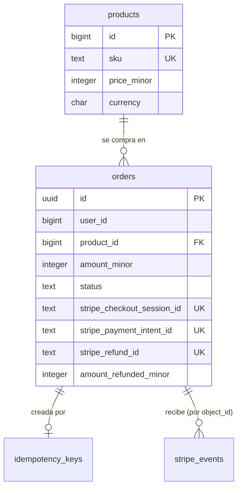

Cuatro tablas: `products`, `orders`, y las dos comunes (`idempotency_keys`, `stripe_events`, sección 2). Los usuarios y la sesión vienen del sistema de login (A12/A13); aquí solo se guarda `user_id`.

```sql
CREATE TABLE products (
  id           bigint  GENERATED ALWAYS AS IDENTITY PRIMARY KEY,
  sku          text    NOT NULL UNIQUE,
  name         text    NOT NULL,
  price_minor  integer NOT NULL CHECK (price_minor >= 50),       -- mínimo de Stripe: 0.50 USD
  currency     char(3) NOT NULL DEFAULT 'usd' CHECK (currency = 'usd'),
  active       boolean NOT NULL DEFAULT true
);

CREATE TABLE orders (
  id                          uuid        PRIMARY KEY DEFAULT uuidv7(),
  user_id                     bigint      NOT NULL,
  product_id                  bigint      NOT NULL REFERENCES products (id),
  quantity                    integer     NOT NULL CHECK (quantity BETWEEN 1 AND 10),
  amount_minor                integer     NOT NULL CHECK (amount_minor > 0),
  currency                    char(3)     NOT NULL CHECK (currency = 'usd'),
  status                      text        NOT NULL DEFAULT 'awaiting_payment'
                              CHECK (status IN ('awaiting_payment', 'processing', 'paid', 'failed', 'expired',
                                                'refund_requested', 'refund_pending', 'refunded', 'refund_failed')),
  checkout_expires_at         timestamptz NOT NULL,   -- se calcula una vez: lo reusa cada reintento hacia Stripe
  stripe_checkout_session_id  text        UNIQUE,
  stripe_payment_intent_id    text        UNIQUE,
  paid_at                     timestamptz,
  stripe_refund_id            text        UNIQUE,     -- re_…: el reembolso que pidió el cliente
  amount_refunded_minor       integer     NOT NULL DEFAULT 0,  -- incluye reembolsos parciales del Dashboard
  refund_requested_at         timestamptz,
  refunded_at                 timestamptz,
  created_at                  timestamptz NOT NULL DEFAULT now(),
  updated_at                  timestamptz NOT NULL DEFAULT now(),
  CHECK (status NOT IN ('paid', 'refund_requested', 'refund_pending', 'refunded', 'refund_failed')
         OR paid_at IS NOT NULL),
  CHECK (amount_refunded_minor BETWEEN 0 AND amount_minor),
  CHECK (status <> 'refunded' OR amount_refunded_minor = amount_minor)
);
CREATE INDEX orders_user ON orders (user_id, created_at DESC);
CREATE INDEX orders_open ON orders (checkout_expires_at) WHERE status = 'awaiting_payment';
-- La propia tabla es la cola de reembolsos: el worker toma de aquí con SKIP LOCKED
CREATE INDEX orders_refund_queue ON orders (refund_requested_at) WHERE status = 'refund_requested';
```

Por qué cada restricción: `amount_minor` y `currency` se congelan al crear (invariante 5); los `UNIQUE` sobre los ids de Stripe impiden que dos órdenes apunten a la misma sesión o al mismo reembolso; `amount_refunded_minor` nunca supera lo cobrado, y una orden `refunded` está devuelta entera; `uuidv7()` da ids ordenables por tiempo sin exponer un contador.

### 4.3 Máquina de estados de la orden

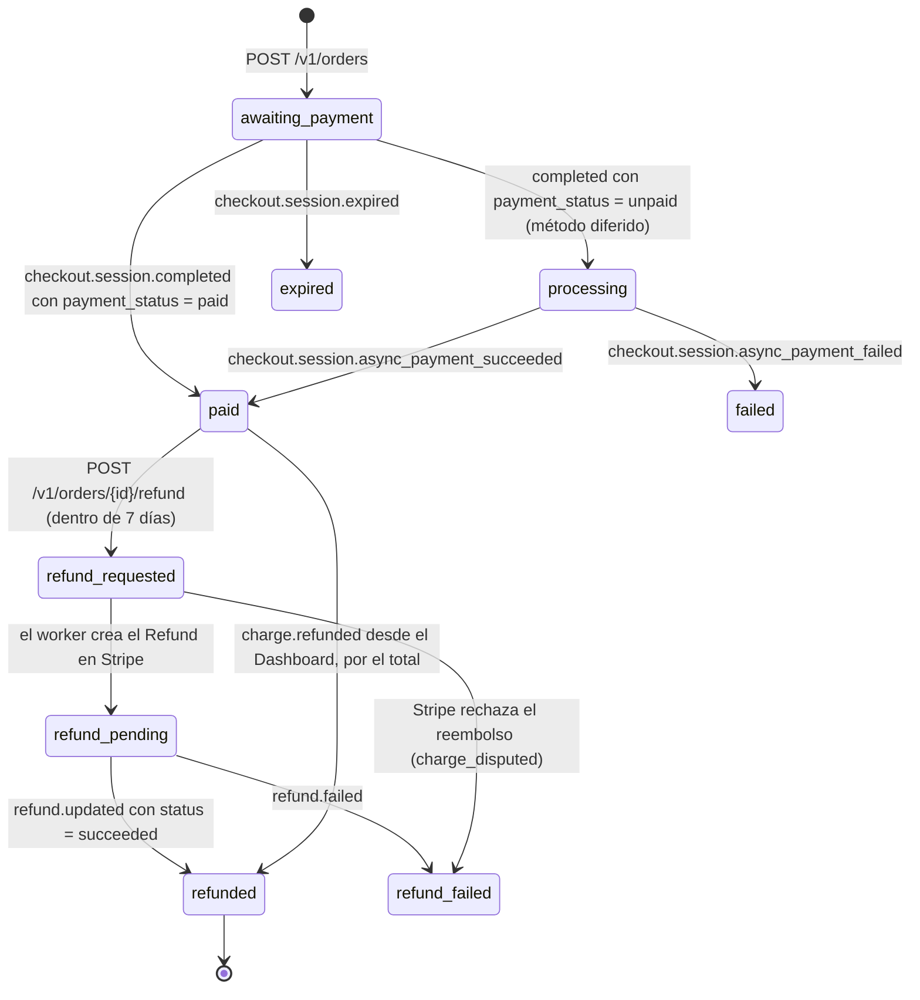

Cada transición es un `UPDATE orders SET status = $nuevo, updated_at = now() WHERE id = $1 AND status = $esperado`. Si devuelve 0 filas, ya se aplicó (o no aplica) y el handler termina sin error: eso hace idempotente al worker sin tabla extra.

### 4.4 API

#### `POST /v1/orders`

```http
POST /v1/orders HTTP/1.1
Cookie: SESSION=…
X-CSRF-Token: …
Idempotency-Key: 6f1c2a9e-3b7d-4f0a-9a51-2c8e0d7b4e13
Content-Type: application/json

{ "product_id": 42, "quantity": 1 }
```

```json
HTTP/1.1 201 Created
{
  "order_id": "01928c3e-7a10-7c4e-9f2b-1d5e8a3c0b71",
  "status": "awaiting_payment",
  "amount": { "minor": 4900, "currency": "usd" },
  "checkout_url": "https://checkout.stripe.com/c/pay/cs_test_…",
  "expires_at": "2026-10-10T20:15:00Z"
}
```

Códigos: `201`, `200` + `Idempotent-Replayed: true` en una repetición, `400`, `401`, `404` (producto inexistente o inactivo), `409 IDEMPOTENCY_IN_PROGRESS`, `422`, `429`, `503`.

#### `GET /v1/orders/{id}`

Estado de la orden (solo el dueño). La página de éxito lo llama con `?session_id=cs_…`: si la orden sigue `awaiting_payment`, el servidor llama a `fulfill(session_id)` (4.7) antes de responder. Stripe recomienda disparar la entrega también desde la página de destino, porque el webhook puede tardar, y nunca **solo** desde ahí, porque el cliente puede no volver *(Documentado)*.

#### `POST /v1/orders/{id}/refund`

Pide el reembolso total. Requiere `Idempotency-Key`; el body es opcional (`{ "reason": "requested_by_customer" }` es el único motivo que acepta).

```json
HTTP/1.1 202 Accepted
{ "order_id": "01928c3e-7a10-7c4e-9f2b-1d5e8a3c0b71", "status": "refund_requested",
  "amount": { "minor": 4900, "currency": "usd" } }
```

`202` porque el reembolso lo hace el worker (4.6). Códigos: `202`, `200` + `Idempotent-Replayed: true`, `404` (no existe o no es tuya), `409 REFUND_NOT_ALLOWED`, `422`, `429` (3 por hora por usuario).

#### `POST /webhooks/stripe`

Sección 2.5.

### 4.5 Flujo completo

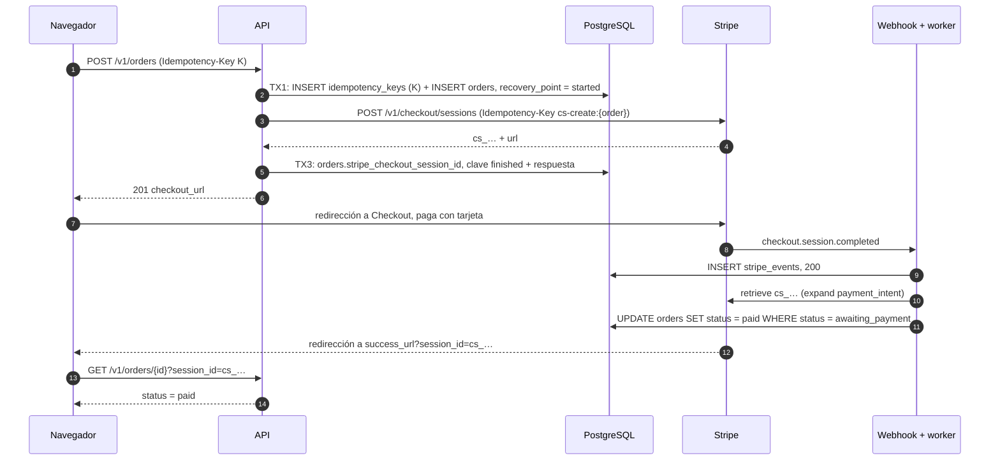

Parámetros de la Checkout Session (todos salen de la orden, ninguno del cliente):

```text
mode                                  = payment
line_items[0][price_data][currency]   = orders.currency
line_items[0][price_data][unit_amount]= products.price_minor (congelado en la orden)
line_items[0][price_data][product_data][name] = products.name
line_items[0][quantity]               = orders.quantity
client_reference_id                   = orders.id
metadata[order_id]                    = orders.id
payment_intent_data[metadata][order_id] = orders.id
customer_email                        = correo del usuario
expires_at                            = orders.checkout_expires_at (created_at + 60 min)
success_url = https://<dominio>/orders/{order_id}/gracias?session_id={CHECKOUT_SESSION_ID}
cancel_url  = https://<dominio>/orders/{order_id}
```

- `expires_at` debe quedar entre 30 min y 24 h después de crear la sesión *(Documentado)*. Se guarda en la orden porque un reintento con otro valor rompería la idempotencia de Stripe. Si un reintento llega tan tarde que faltan menos de 30 min, Stripe rechaza la request: la orden pasa a `expired` y se responde `410`; el cliente empieza una compra nueva.
- `{CHECKOUT_SESSION_ID}` lo reemplaza Stripe al redirigir *(Documentado)*. Checkout espera hasta 10 s a que el webhook de `checkout.session.completed` responda antes de redirigir *(Documentado)*: otra razón para responder 200 rápido.

### 4.6 Reembolsos

**Política** *(Diseño de referencia)*: reembolso total, pedido por el dueño, hasta 7 días después de `paid_at` (`pagos.refunds.window: 7d`). El dinero vuelve solo al método de pago original *(Documentado)*, así que una sesión robada no puede desviarlo a otra cuenta; lo peor que puede hacer es devolver una compra, y eso se limita con el rate limit y un correo de aviso al dueño.

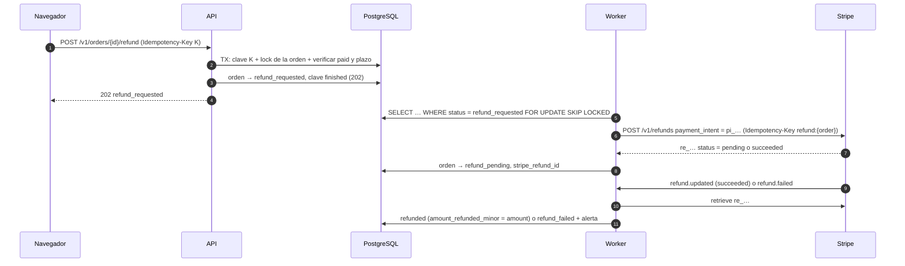

**La API no llama a Stripe para reembolsar.** El endpoint es una sola transacción (como reservar en V2): verifica, marca `refund_requested` y responde `202`. El worker hace la llamada. Así `rk_api` no necesita permiso de Refunds, y una API comprometida no puede devolver dinero por su cuenta.

```sql
-- Endpoint (una transacción, con la clave de idempotencia de 2.4 dentro)
SELECT status, paid_at, amount_refunded_minor FROM orders
WHERE id = $order AND user_id = $user
FOR UPDATE;                                    -- no existe o no es tuya: 404
-- status <> 'paid' o paid_at <= now() - $window o amount_refunded_minor > 0: 409 REFUND_NOT_ALLOWED
UPDATE orders SET status = 'refund_requested', refund_requested_at = now(), updated_at = now()
WHERE id = $order;

-- Worker (cada 5 s): toma un lote
SELECT id, stripe_payment_intent_id, amount_minor FROM orders
WHERE status = 'refund_requested'
ORDER BY refund_requested_at
LIMIT 20
FOR UPDATE SKIP LOCKED;
```

Parámetros del reembolso: `payment_intent = orders.stripe_payment_intent_id`, sin `amount` (total), `reason = requested_by_customer`, `metadata[order_id] = orders.id`, `Idempotency-Key: refund:{order_id}`.

Qué hace el worker con cada respuesta de Stripe (por el estado del objeto, no por el texto del error):

| Respuesta | Qué hace |
|---|---|
| `Refund` con `status = succeeded` | `refunded`, `amount_refunded_minor = amount_minor`, `refunded_at = now()` |
| `Refund` con `status = pending` | `refund_pending`; espera `refund.updated`. Pasa, por ejemplo, si el saldo de Stripe no alcanza: con tarjeta, Stripe deja el reembolso pendiente hasta que alcance *(Documentado)* |
| Error `charge_already_refunded` | Leer los reembolsos del cargo y marcar `refunded`: alguien lo devolvió desde el Dashboard |
| Error `charge_disputed` | `refund_failed`, `last_error = 'charge_disputed'`, alerta: la disputa se responde aparte; reembolsar además devolvería el dinero dos veces |
| Error de red, `rate_limit` o `lock_timeout` | Nada: la orden sigue `refund_requested` y el próximo ciclo reintenta con la misma clave |
| Evento `refund.failed` | `refund_failed` + alerta. Stripe pide resolver la devolución por otro medio *(Documentado)* |

Lo que el cliente tiene que saber, y la pantalla le dice: el reembolso tarda unos 5 a 10 días hábiles en verse *(Documentado)*; si se pide poco después del cobro, puede aparecer como una reversión y el cargo simplemente desaparece del estado de cuenta *(Documentado)*; y Stripe no devuelve su comisión del cobro original *(Documentado)*, así que cada reembolso le cuesta al comercio.

**Reembolsos desde el Dashboard.** `charge.refunded` llega también por los que hace una persona del equipo, incluidos los parciales. El worker lee el cargo y copia `amount_refunded` a `amount_refunded_minor`; si cubre el total, la orden pasa a `refunded`. Un reembolso parcial deja la orden `paid` con el monto devuelto a la vista.

### 4.7 LLD de V1

```text
com.ejemplo.pagos
├── config/
│   ├── StripeProperties        @ConfigurationProperties("pagos.stripe"): apiKey, webhookSecret, tolerance
│   └── StripeConfig            @Bean StripeClient (clave del perfil)
├── idem/
│   ├── IdempotencyKey          record(userId, key, methodPath, requestHash)
│   ├── IdempotencyRecord       record(..., recoveryPoint, lockedUntil, resourceId, status, body)
│   ├── RequestHasher           SHA-256 de JSON canónico
│   ├── IdempotencyRepository   claim(), advance(), finish(), find()
│   └── IdempotentExecutor      ejecuta un endpoint por fases (abajo)
├── order/
│   ├── OrderController         POST /v1/orders, GET /v1/orders/{id}, POST /v1/orders/{id}/refund
│   ├── OrderService            create() en tres fases, fulfill(sessionId), requestRefund()
│   ├── RefundWorker            @Scheduled(fixedDelay = 5s): toma refund_requested con SKIP LOCKED (perfil worker)
│   ├── OrderRepository         JdbcClient, transiciones con WHERE status = esperado
│   └── OrderStatus             enum con transiciones permitidas
├── payment/
│   ├── PaymentGateway          interfaz: createCheckoutSession, retrieveCheckoutSession, createRefund, retrieveRefund
│   ├── StripePaymentGateway    implementación con StripeClient + RequestOptions.setIdempotencyKey
│   └── FakePaymentGateway      para pruebas: guion de respuestas y fallas
├── webhook/
│   ├── StripeWebhookController POST /webhooks/stripe (perfil webhook)
│   ├── StripeEventInbox        insertIfAbsent(event)
│   └── StripeEventWorker       @Scheduled(fixedDelay = 1s), lote con SKIP LOCKED (perfil worker)
└── web/
    ├── ApiExceptionHandler     @RestControllerAdvice: errores de la sección 3
    └── SecurityConfig          sesión + CSRF, webhook exento y permitAll
```

Contratos clave:

```java
public interface PaymentGateway {
    CheckoutSessionRef createCheckoutSession(Order order, String idempotencyKey);
    CheckoutSessionView retrieveCheckoutSession(String sessionId);   // con payment_intent expandido
    RefundView createRefund(String paymentIntentId, String orderId, String idempotencyKey);
    RefundView retrieveRefund(String refundId);
}

public final class IdempotentExecutor {
    /** Corre las fases que falten según el recovery_point guardado; cada fase en su transacción. */
    public <T> StoredResponse run(IdempotencyKey key, Phases<T> phases) { … }
}
```

`OrderService.create` en fases:

1. **TX1** (`TransactionTemplate`): `claim(key)` → si la clave es nueva, inserta la fila con `locked_until = now() + 30 s` y la orden con `checkout_expires_at = now() + interval '60 minutes'`, `resource_id = order.id`. Si existe y está `finished`, devuelve la respuesta guardada. Si existe con otro `request_hash`, `422`.
2. **Fase remota** (sin transacción): `createCheckoutSession(order, "cs-create:" + order.id)`. Un `StripeException` de red o 5xx deja la clave en `started` y responde `503`; el reintento del cliente vuelve aquí con la misma clave de Stripe y recibe la misma sesión.
3. **TX3:** `UPDATE orders SET stripe_checkout_session_id = …`, `finish(key, 201, body)`, `locked_until = NULL`.

`fulfill(sessionId)`, llamado por el worker y por la página de éxito, idempotente y seguro en concurrencia:

```java
CheckoutSessionView s = gateway.retrieveCheckoutSession(sessionId);      // fuera de transacción
Order o = orders.findBySession(sessionId);
requireSame(o.amountMinor(), s.amountTotal(), o.currency(), s.currency()); // invariante 5: si no coincide, alerta y no entrega
switch (s.paymentStatus()) {
    case "paid"   -> orders.transition(o.id(), Set.of(AWAITING_PAYMENT, PROCESSING), PAID, s.paymentIntentId());
    case "unpaid" -> orders.transition(o.id(), Set.of(AWAITING_PAYMENT), PROCESSING, s.paymentIntentId());
    default       -> { }  // no_payment_required no aplica en este catálogo
}
```

`transition` es un `UPDATE … WHERE status = ANY(:desde) RETURNING id`; dos llamadas concurrentes se ordenan por el lock de fila implícito del `UPDATE` y solo una ve la fila.

### 4.8 Qué puede salir mal en V1

| Escenario | Qué pasa | Por qué no duplica ni pierde |
|---|---|---|
| Doble clic en "Pagar" | Dos requests con la misma clave | La segunda espera el lease o recibe `409`, y su reintento repite el `201` guardado |
| La API muere después de crear la sesión en Stripe y antes de TX3 | La clave queda en `started` | El reintento repite la llamada con `cs-create:{order}` y Stripe devuelve la misma sesión |
| El cliente cambia la cantidad y reintenta con la misma clave | Body distinto | `422 IDEMPOTENCY_KEY_REUSED` |
| El webhook llega antes que la redirección | Normal | La página de éxito ve `paid` |
| La redirección llega antes que el webhook | Normal | `GET /orders/{id}?session_id=` llama a `fulfill` |
| El webhook llega dos veces | Mismo `event_id` | `ON CONFLICT DO NOTHING`; y la transición solo avanza |
| Webhook falso | Firma inválida | `400`, nada se escribe |
| Stripe cae al crear la sesión | `StripeException` | `503`, clave en `started`; reintento seguro |
| El cliente cierra la pestaña sin pagar | La sesión vence a los 60 min | `checkout.session.expired` → `expired` |
| Reembolso desde el Dashboard | `charge.refunded` | El worker lee el cargo: si `amount_refunded = amount`, pasa a `refunded`; si es parcial, guarda el monto |
| Doble clic en "Pedir reembolso" | Misma clave | Una sola transición; la segunda repite el `202` |
| Dos pestañas piden el reembolso con claves distintas | La segunda ve `refund_requested` | `409 REFUND_NOT_ALLOWED`; Stripe recibe un solo reembolso |
| El worker muere después de crear el reembolso en Stripe | La orden sigue `refund_requested` | El reintento usa `refund:{order}` y Stripe devuelve el mismo `re_…` |
| El reembolso falla días después | `refund.failed` | `refund_failed` + alerta; nadie lo da por devuelto |

---

# PARTE V2 — Boletos de cine con locks pesimistas y etapas

## 5. V2: 100 asientos, reserva de 30 s, checkout de 3 min

### 5.1 Reglas del negocio

1. Una función tiene 100 asientos numerados (filas A–J, 10 por fila).
2. **Etapa 1, reservar.** El usuario elige de 1 a 10 asientos y los reserva. Durante **30 s** todos los ven **apartados**. Si en 30 s no pasa al checkout, se liberan.
3. **Etapa 2, checkout.** Al pasar al checkout, los asientos quedan apartados **3 min** desde ese momento. Si no paga en 3 min, se liberan.
4. **Etapa 3, pagado.** Si paga, los asientos quedan vendidos para siempre y recibe un **código por asiento**.
5. Quien intenta reservar un asiento apartado, en checkout o vendido recibe `409 SEAT_UNAVAILABLE` con el motivo y, si está apartado, hasta cuándo.
6. Cada acción lleva `Idempotency-Key`: el reintento de la misma reserva devuelve la misma reserva, no una segunda.

### 5.2 Qué significa aquí "lock pesimista de 30 s"

Un lock de fila de PostgreSQL (`FOR UPDATE`) dura lo que dura su **transacción**. Mantener una transacción abierta 30 s o 3 min mientras una persona mira la pantalla es inviable: ocupa una conexión de PgBouncer por usuario (con un pool de 20, el usuario 21 espera), bloquea el `VACUUM` de esas filas y cualquier caída deja el lock colgado hasta que la conexión muera.

Por eso el diseño tiene **dos niveles de lock**:

| Nivel | Qué es | Cuánto dura | Para qué |
|---|---|---|---|
| Lock de fila (pesimista, físico) | `SELECT … FOR UPDATE NOWAIT` sobre las filas de los asientos | Milisegundos: lo que tarda la transacción de reservar, pasar a checkout o vender | Que dos transacciones no evalúen y cambien el mismo asiento a la vez |
| Hold (lógico, con vencimiento) | `seats.status = 'held'` o `'checkout'` con `hold_expires_at` | 30 s o 3 min | Que todos vean el asiento apartado entre requests |

El lock físico protege la **transición**; el hold representa el **apartado**. Es pesimista en el sentido de que bloquea antes de leer y decidir, y no reintenta como el optimista: si la fila está tomada, falla de inmediato.

`NOWAIT` en lugar de esperar: si dos personas pulsan F7 en el mismo milisegundo, la segunda no espera a la primera para luego descubrir que el asiento ya está apartado; recibe `55P03` al instante y se traduce a `409`. Como ninguna transacción espera, no hay deadlocks. Igual se toman los locks en orden de `id` (por si una versión futura cambia a `lock_timeout`).

El nivel de aislamiento es `READ COMMITTED`: `FOR UPDATE` lee la última versión confirmada de la fila y la bloquea, así que no hace falta `SERIALIZABLE` (M05 explica por qué).

### 5.3 Línea de tiempo de un asiento

```mermaid
gantt
  title Asiento F7: una compra exitosa y una abandonada
  dateFormat  HH:mm:ss
  axisFormat  %M:%S
  section Ana (paga)
  held               :a1, 19:00:00, 12s
  checkout           :a2, after a1, 95s
  sold               :milestone, m1, after a2, 0s
  section Beto (abandona F8)
  held               :b1, 19:00:05, 30s
  liberado           :milestone, m2, after b1, 0s
```

Ana reserva F7 a las 19:00:00, pasa al checkout a los 12 s (su hold de 30 s se reemplaza por uno de 3 min que cuenta desde 19:00:12) y paga a los 95 s de checkout. Beto reserva F8 a las 19:00:05 y no avanza: a las 19:00:35 F8 vuelve a estar libre.

### 5.4 Arquitectura de V2

La de la sección 2.2, con tres agregados:

- **Barrido** (perfil `worker`, cada 5 s): vence reservas, cancela el PaymentIntent de las que estaban en checkout y libera asientos.
- **Mapa en vivo por SSE** (decidido el 2026-10-10; diseño completo en 5.15): `GET /v1/showings/{id}/seats/stream`. Después de cada commit que cambia asientos, quien hizo el cambio publica en Redis Pub/Sub y cada réplica reenvía a sus clientes. No se usa `LISTEN/NOTIFY` de PostgreSQL porque necesita una sesión dedicada, que PgBouncer en modo transacción no da.
- **Payment Element con PaymentIntents** en lugar de Checkout: una Checkout Session no puede vencer antes de 30 min *(Documentado)*, y aquí el checkout dura 3. Stripe recomienda hoy Checkout Sessions con `ui_mode: "elements"` para la mayoría de las integraciones *(Documentado)*, pero el PaymentIntent de una Checkout Session solo se cancela directamente en `requires_capture`; en los demás estados hay que vencer la sesión entera *(Documentado)*. El barrido y la prórroga de 5.12 necesitan leer y cancelar el PaymentIntent en cualquier estado, así que V2 y V3 crean el PaymentIntent ellas mismas. (Alternativa válida: Checkout hospedado con vencimiento manual a los 3 min con `POST /v1/checkout/sessions/{id}/expire`; se descarta por la redirección, que se come parte de los 3 min, y porque el mapa de asientos quedaría en otra página.)

### 5.5 Base de datos

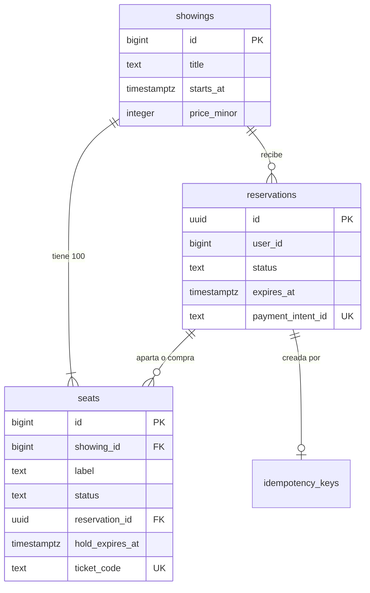

```sql
CREATE TABLE showings (
  id           bigint      GENERATED ALWAYS AS IDENTITY PRIMARY KEY,
  title        text        NOT NULL,
  starts_at    timestamptz NOT NULL,
  price_minor  integer     NOT NULL CHECK (price_minor >= 50),   -- 850 = 8.50 USD por asiento en los ejemplos
  currency     char(3)     NOT NULL DEFAULT 'usd' CHECK (currency = 'usd')
);

CREATE TABLE reservations (
  id                 uuid        PRIMARY KEY DEFAULT uuidv7(),
  user_id            bigint      NOT NULL,
  showing_id         bigint      NOT NULL REFERENCES showings (id),
  status             text        NOT NULL
                     CHECK (status IN ('held', 'checkout', 'paid', 'expired', 'canceled', 'refunded')),
  seat_count         smallint    NOT NULL CHECK (seat_count BETWEEN 1 AND 10),
  amount_minor       integer     NOT NULL CHECK (amount_minor > 0),
  currency           char(3)     NOT NULL,
  expires_at         timestamptz NOT NULL,     -- vence el hold de la etapa actual
  grace_used         boolean     NOT NULL DEFAULT false,  -- la prórroga de 3D Secure (5.12) se da una sola vez
  payment_intent_id  text        UNIQUE,
  paid_at            timestamptz,
  created_at         timestamptz NOT NULL DEFAULT now(),
  updated_at         timestamptz NOT NULL DEFAULT now()
);
-- Una reserva activa por usuario y función (anti-acaparamiento, regla 2.6)
CREATE UNIQUE INDEX one_active_reservation
  ON reservations (user_id, showing_id) WHERE status IN ('held', 'checkout');
CREATE INDEX reservations_due ON reservations (expires_at) WHERE status IN ('held', 'checkout');

CREATE TABLE seats (
  id               bigint      GENERATED ALWAYS AS IDENTITY PRIMARY KEY,
  showing_id       bigint      NOT NULL REFERENCES showings (id),
  label            text        NOT NULL,                 -- 'F7'
  status           text        NOT NULL DEFAULT 'available'
                   CHECK (status IN ('available', 'held', 'checkout', 'sold')),
  reservation_id   uuid        REFERENCES reservations (id),
  hold_expires_at  timestamptz,
  ticket_code      text        UNIQUE,
  updated_at       timestamptz NOT NULL DEFAULT now(),
  UNIQUE (showing_id, label),
  -- La base rechaza combinaciones imposibles aunque el código tenga un bug:
  CHECK ((status = 'available') = (reservation_id IS NULL)),
  CHECK ((status IN ('held', 'checkout')) = (hold_expires_at IS NOT NULL)),
  CHECK ((status = 'sold') = (ticket_code IS NOT NULL))
);
CREATE INDEX seats_reservation ON seats (reservation_id) WHERE reservation_id IS NOT NULL;
```

El invariante 2 lo sostiene la propia forma de la tabla: un asiento es **una fila** con **un** `reservation_id`; no puede pertenecer a dos reservas. La `UNIQUE (showing_id, label)` impide que existan dos F7.

Roles: `pagos_api` con `SELECT, UPDATE` en `seats` y `SELECT, INSERT, UPDATE` en `reservations`; `pagos_worker` con `SELECT, UPDATE` en las dos. Nadie tiene `INSERT` ni `DELETE` en `seats` salvo el rol de migraciones, que crea los 100 asientos al crear la función.

### 5.6 Máquinas de estados

Asiento:

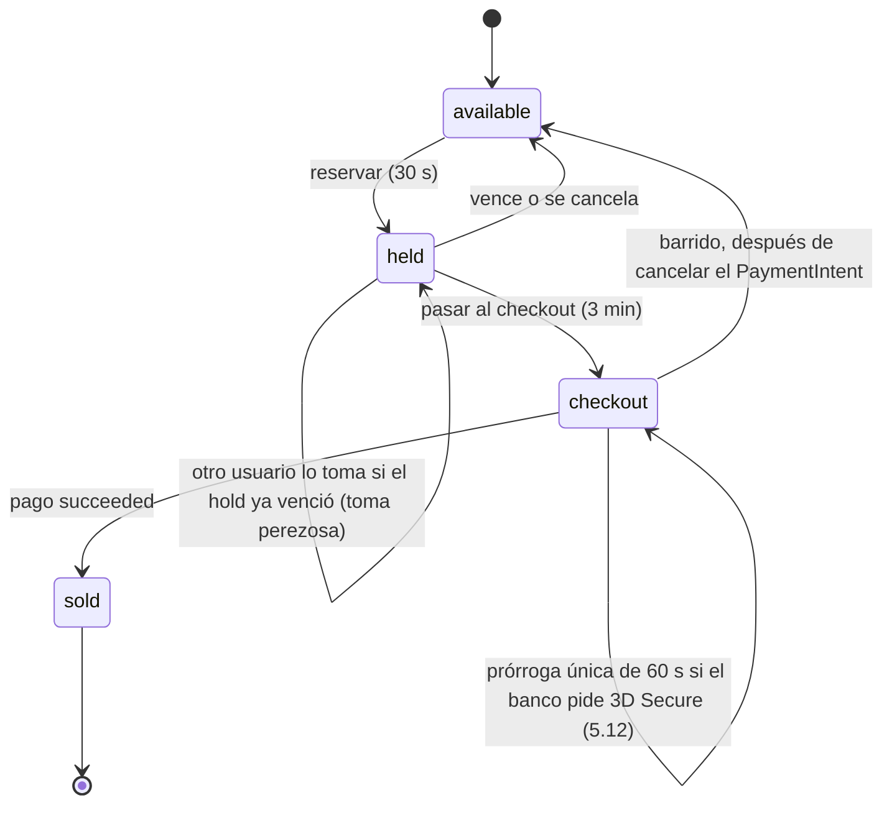

Reserva:

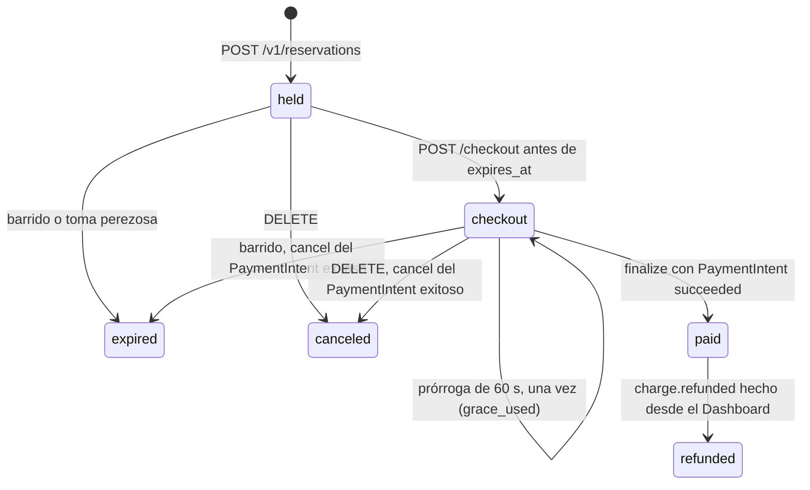

Los boletos vendidos no se reembolsan desde la aplicación (decidido el 2026-10-10: solo V1 tiene reembolsos). Si alguien del equipo reembolsa desde el Dashboard, el worker marca la reserva `refunded`, deja los asientos vendidos (no se revenden solos) y alerta.

**La regla más importante de V2:** un asiento en `held` vencido se puede tomar en el momento (no hay dinero en juego), pero un asiento en `checkout` vencido **no**: solo lo libera el barrido, y solo después de que Stripe confirme que el PaymentIntent quedó `canceled`. Si se liberara antes, el primer usuario podría terminar de pagar un asiento que ya es de otro. Mientras tanto, el mapa lo sigue mostrando apartado.

### 5.7 API

#### `GET /v1/showings/{id}/seats`

```json
{
  "showing_id": 7,
  "server_time": "2026-10-10T19:00:20.512Z",
  "seats": [
    { "label": "F7", "status": "checkout", "held_until": "2026-10-10T19:03:12.004Z", "mine": true },
    { "label": "F8", "status": "held",     "held_until": "2026-10-10T19:00:35.101Z", "mine": false },
    { "label": "F9", "status": "available" },
    { "label": "G1", "status": "sold" }
  ]
}
```

El estado que se muestra es el **efectivo**: un `held` con `hold_expires_at <= now()` se muestra `available`. Un `checkout` vencido se sigue mostrando `checkout` hasta que el barrido lo libere. `Cache-Control: no-store`.

```sql
SELECT label,
       CASE WHEN status = 'held' AND hold_expires_at <= now() THEN 'available' ELSE status END AS status,
       CASE WHEN status IN ('held', 'checkout') AND hold_expires_at > now() THEN hold_expires_at END AS held_until,
       (reservation_id IS NOT NULL AND reservation_id IN (
          SELECT id FROM reservations WHERE user_id = $2 AND showing_id = $1)) AS mine,
       now() AS server_time
FROM seats
WHERE showing_id = $1
ORDER BY id;          -- los asientos se crean en orden A1…J10
```

#### `POST /v1/reservations`

```http
POST /v1/reservations
Idempotency-Key: 2b0f7c1e-5d4a-4c39-8e21-9a6f3d0c5b88
Content-Type: application/json

{ "showing_id": 7, "seats": ["F7", "F8"] }
```

```json
HTTP/1.1 201 Created
{
  "reservation_id": "01928c41-0b2e-7f13-a5d0-6c9e2b7a1f40",
  "status": "held",
  "seats": ["F7", "F8"],
  "amount": { "minor": 1700, "currency": "usd" },
  "expires_at": "2026-10-10T19:00:30.004Z",
  "server_time": "2026-10-10T19:00:00.004Z"
}
```

Errores: `409 SEAT_UNAVAILABLE` (con la lista de asientos y su motivo), `409 ACTIVE_RESERVATION_EXISTS` (con `reservation_id`), `400` (asiento inexistente, más de 10, lista vacía o repetida), `422`, `429`.

#### `POST /v1/reservations/{id}/checkout`

Requiere `Idempotency-Key`. Sin body.

```json
HTTP/1.1 200 OK
{
  "reservation_id": "01928c41-0b2e-7f13-a5d0-6c9e2b7a1f40",
  "status": "checkout",
  "expires_at": "2026-10-10T19:03:12.004Z",
  "server_time": "2026-10-10T19:00:12.004Z",
  "payment": {
    "payment_intent_id": "pi_3Q…",
    "client_secret": "pi_3Q…_secret_…",
    "amount": { "minor": 1700, "currency": "usd" }
  }
}
```

Errores: `410 RESERVATION_EXPIRED`, `409 INVALID_STATE`, `404`, `503`.

#### `POST /v1/reservations/{id}/confirm`

Lo llama el navegador cuando `stripe.confirmPayment({ elements, redirect: 'if_required' })` resuelve. No lleva clave: es una sincronización idempotente (lee el PaymentIntent en Stripe y llama a `finalize`).

```json
HTTP/1.1 200 OK
{
  "status": "paid",
  "tickets": [ { "seat": "F7", "code": "TK-7K3Q9XPA2M4D" }, { "seat": "F8", "code": "TK-H2N8R5WC1QJE" } ]
}
```

`202 { "status": "processing" }` si Stripe todavía no decidió; el navegador espera el SSE o vuelve a llamar. `402 PAYMENT_FAILED` con `decline_code` si la tarjeta fue rechazada: la reserva sigue en `checkout` y puede reintentar con otra tarjeta dentro del plazo. `410 RESERVATION_EXPIRED` si el plazo (con la prórroga, si la hubo) venció y el PaymentIntent quedó cancelado. Cómo maneja cada caso el navegador: 5.12.

#### `DELETE /v1/reservations/{id}`

Cancela y libera. En `checkout`, primero cancela el PaymentIntent (`pi-cancel:{pi}`); si Stripe responde que ya está `succeeded`, responde `409 INVALID_STATE` y deja que `finalize` venda. `204` si liberó.

#### `GET /v1/reservations/{id}`

Estado y boletos. Solo el dueño. Es la fuente de verdad del navegador cuando algo falla (5.12).

```json
{ "reservation_id": "01928c41-…", "status": "checkout", "expires_at": "2026-10-10T19:04:12.004Z",
  "grace_used": true, "server_time": "2026-10-10T19:03:14.900Z", "seats": ["F7", "F8"] }
```

### 5.8 Reservar: la transacción exacta

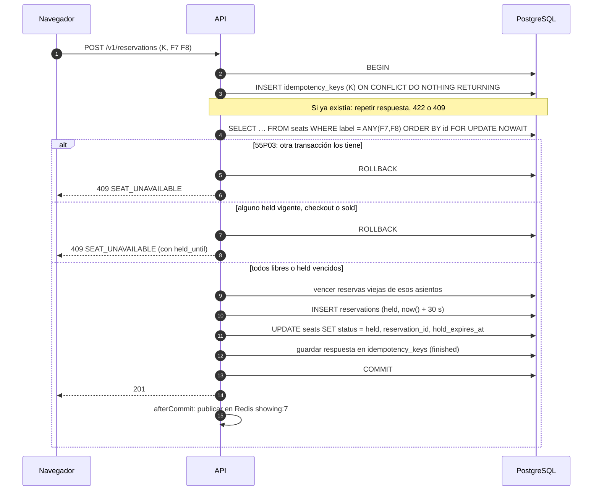

Esta etapa no llama a Stripe, así que **cabe en una sola transacción**: la fila de la clave, la reserva y los asientos se confirman juntos o no se confirma nada. No hace falta el lease de 2.4: si llega una segunda request con la misma clave, su `INSERT … ON CONFLICT DO NOTHING` espera a que la primera termine y después ve la fila confirmada (y repite la respuesta) o no la ve (la primera falló sin efectos y la segunda ejecuta normalmente).

```sql
-- 1. Clave de idempotencia (dentro de la misma transacción)
INSERT INTO idempotency_keys (user_id, idem_key, method_path, request_hash)
VALUES ($user, $key, 'POST /v1/reservations', $hash)
ON CONFLICT (user_id, idem_key) DO NOTHING
RETURNING 1;
-- 0 filas: SELECT de la fila existente → repetir, 422 o 409 según 2.4

-- 2. Lock de los asientos, en orden de id, sin esperar
SELECT id, label, status, reservation_id, hold_expires_at
FROM seats
WHERE showing_id = $showing AND label = ANY($labels)
ORDER BY id
FOR UPDATE NOWAIT;
-- Menos filas que labels: 400 (asiento inexistente)
-- Disponible = status = 'available' OR (status = 'held' AND hold_expires_at <= now())
-- Cualquier otro: ROLLBACK y 409 con su status y hold_expires_at

-- 3. Vencer las reservas de los holds vencidos que se van a pisar (toma perezosa)
UPDATE reservations SET status = 'expired', updated_at = now()
WHERE id = ANY($old_reservation_ids) AND status = 'held';

-- 4. Vencer una reserva propia vencida que siga 'held' (si no, el índice único la bloquearía)
UPDATE reservations SET status = 'expired', updated_at = now()
WHERE user_id = $user AND showing_id = $showing AND status = 'held' AND expires_at <= now();

-- 5. Crear la reserva (23505 en one_active_reservation → 409 ACTIVE_RESERVATION_EXISTS)
INSERT INTO reservations (user_id, showing_id, status, seat_count, amount_minor, currency, expires_at)
SELECT $user, s.id, 'held', $n, s.price_minor * $n, s.currency, now() + interval '30 seconds'
FROM showings s WHERE s.id = $showing
RETURNING id, expires_at;

-- 6. Apartar
UPDATE seats
SET status = 'held', reservation_id = $res, hold_expires_at = $expires_at, updated_at = now()
WHERE id = ANY($seat_ids);

-- 7. Cerrar la clave
UPDATE idempotency_keys
SET recovery_point = 'finished', resource_id = $res, response_status = 201, response_body = $body
WHERE user_id = $user AND idem_key = $key;
COMMIT;
```

`SET LOCAL statement_timeout = '2s'` al inicio de la transacción: si algo se traba, la request falla rápido en lugar de ocupar la conexión.

### 5.9 Checkout: fases y PaymentIntent

```mermaid
sequenceDiagram
  autonumber
  participant B as Navegador
  participant A as API
  participant DB as PostgreSQL
  participant S as Stripe
  B->>A: POST /reservations/{id}/checkout (K2)
  A->>DB: TX1: clave K2 started + lock reserva + verificar held y no vencida
  A->>DB: TX1: seats → checkout, hold_expires_at = now() + 3 min; reserva → checkout
  A->>S: POST /v1/payment_intents (Idempotency-Key pi-create:{reserva})
  S-->>A: pi_… + client_secret
  A->>DB: TX3: reserva.payment_intent_id (si sigue en checkout) + clave finished
  A-->>B: 200 client_secret + expires_at
  B->>S: stripe.confirmPayment (tarjeta, 3D Secure si hace falta)
  S-->>B: resultado
  B->>A: POST /reservations/{id}/confirm
  A->>S: retrieve pi_…
  A->>DB: finalize: seats → sold + códigos, reserva → paid
  A-->>B: 200 tickets
  S->>A: payment_intent.succeeded (webhook, respaldo)
```

**TX1:**

```sql
SELECT status, expires_at, seat_count FROM reservations
WHERE id = $res AND user_id = $user
FOR UPDATE;                                -- no existe o no es tuya: 404
-- status = 'checkout': es un reintento de otra clave → 409 INVALID_STATE con el estado actual
-- status <> 'held' o expires_at <= now(): 410 RESERVATION_EXPIRED

UPDATE seats
SET status = 'checkout', hold_expires_at = now() + interval '3 minutes', updated_at = now()
WHERE reservation_id = $res AND status = 'held';
-- filas <> seat_count: alguien tomó un asiento tras el vencimiento → ROLLBACK, 410

UPDATE reservations
SET status = 'checkout', expires_at = now() + interval '3 minutes', updated_at = now()
WHERE id = $res;
```

No hace falta `FOR UPDATE NOWAIT` explícito sobre los asientos: el `UPDATE` toma el lock de fila, y una reserva concurrente de otro usuario sobre esos asientos choca con `NOWAIT` y recibe `409`.

**Fase remota:**

```text
POST /v1/payment_intents                    Idempotency-Key: pi-create:{reservation_id}
amount                    = reservations.amount_minor
currency                  = reservations.currency
payment_method_types[]    = card
metadata[reservation_id]  = reservations.id
metadata[showing_id]      = reservations.showing_id
description               = "Función 7, asientos F7 F8"
receipt_email             = correo del usuario
```

Antes de llamar, se relee el estado (sin lock): si ya no está en `checkout` (el barrido lo venció mientras la API estaba caída), no se crea el PaymentIntent y se responde `410`.

**TX3:** `UPDATE reservations SET payment_intent_id = $pi WHERE id = $res AND status = 'checkout'`. Si devuelve 0 filas (la reserva venció entre la fase remota y TX3), se cancela el PaymentIntent con `pi-cancel:{pi}` y se responde `410`. El PaymentIntent queda creado y cancelado: no hay dinero en juego porque nadie lo confirmó.

### 5.10 Pagar: `finalize` y el código de asiento

`finalize(paymentIntentId)` lo llaman `POST /confirm` y el worker al procesar `payment_intent.succeeded`. Es idempotente y seguro en concurrencia.

```java
PaymentIntentView pi = gateway.retrievePaymentIntent(piId);     // fuera de transacción
if (!pi.status().equals("succeeded")) return Outcome.of(pi.status());   // processing, requires_payment_method…
tx.execute(status -> {
    Reservation r = reservations.lockByPaymentIntent(piId);     // SELECT … FOR UPDATE
    if (r.status() == PAID) return Outcome.paid(tickets.of(r));  // ya se hizo
    requireSame(r.amountMinor(), pi.amount(), r.currency(), pi.currency(), r.id(), pi.metadata("reservation_id"));
    if (r.status() != CHECKOUT) {                                // no debería pasar: el barrido cancela antes de liberar
        alerts.critical("pago sin asientos", r.id(), piId);
        outbox.enqueue(new RefundRequested(piId));               // invariante 4
        return Outcome.refunding();
    }
    int n = seats.sell(r.id(), codes::next);                     // UPDATE … status = 'sold', ticket_code
    if (n != r.seatCount()) throw new IllegalStateException();    // ROLLBACK
    reservations.markPaid(r.id());
    outbox.enqueue(new TicketsIssued(r.id()));                   // correo con los códigos
    return Outcome.paid(tickets.of(r));
});
```

`finalize` **no** mira `expires_at`: si Stripe dice `succeeded` y la reserva sigue en `checkout`, se vende aunque hayan pasado los 3 min. Eso solo ocurre si el barrido intentó cancelar y Stripe respondió que el pago ya estaba en curso o terminado (5.11): el dinero ganó la carrera y el asiento sigue siendo de ese usuario.

```sql
UPDATE seats
SET status = 'sold', ticket_code = $code_for_each_seat, hold_expires_at = NULL, updated_at = now()
WHERE reservation_id = $res AND status = 'checkout';
```

(En la guía, un `UPDATE … FROM (VALUES …)` con un código por asiento.)

**Código de asiento.** `TK-` + 12 caracteres de base32 de Crockford (sin I, L, O ni U) con 60 bits de `SecureRandom`. Con `UNIQUE (ticket_code)`, una colisión hace fallar la transacción y se reintenta con otro código. Probabilidad de que choquen dos códigos entre n emitidos: unas n²/2⁶¹; con 10 millones de boletos, 10¹⁴ / 2.3·10¹⁸ ≈ 4·10⁻⁵. El QR del boleto lleva solo el código; en la puerta, el escáner hace `UPDATE seats SET checked_in_at = now() WHERE ticket_code = $1 AND checked_in_at IS NULL` (una sola entrada por boleto; columna `checked_in_at` que se suma en la guía si se construye la puerta).

### 5.11 Vencer: toma perezosa + barrido

Dos mecanismos, cada uno con su trabajo:

| Mecanismo | Qué vence | Cuándo |
|---|---|---|
| Toma perezosa (5.8, pasos 3 y 4) | `held` vencidos, al intentar reservarlos | En la transacción de otro usuario que los pide |
| Barrido (worker, cada 5 s, lotes de 100) | `held` vencidos que nadie pidió, y **todos** los `checkout` vencidos | Siempre |

Barrido de `held` (sin dinero en juego, una transacción):

```sql
WITH due AS (
  SELECT id FROM reservations
  WHERE status = 'held' AND expires_at <= now()
  ORDER BY expires_at
  LIMIT 100
  FOR UPDATE SKIP LOCKED
), expired AS (
  UPDATE reservations r SET status = 'expired', updated_at = now()
  FROM due WHERE r.id = due.id
  RETURNING r.id
)
UPDATE seats
SET status = 'available', reservation_id = NULL, hold_expires_at = NULL, updated_at = now()
WHERE reservation_id IN (SELECT id FROM expired) AND status = 'held';
```

`SKIP LOCKED` permite correr el barrido en todas las réplicas del worker sin elegir líder: cada una toma filas distintas.

Barrido de `checkout` (con dinero en juego, por reserva):

1. Leer candidatas: `status = 'checkout' AND expires_at <= now()`.
2. Si no tiene `payment_intent_id` (la API murió antes de crearlo), ir directo al paso 4.
3. Leer el PaymentIntent (`retrieve`) y decidir por su `status`:

   | `status` del PaymentIntent | Qué hace el barrido |
   |---|---|
   | `requires_payment_method`, `requires_confirmation` | Cancelar con `pi-cancel:{pi}` y `cancellation_reason = abandoned`, y seguir al paso 4 |
   | `requires_action` y `grace_used = false` | **Prórroga** (5.12): no cancela; extiende 60 s |
   | `requires_action` y `grace_used = true` | Cancelar y seguir al paso 4 |
   | `processing` | No liberar. Con tarjeta, un PaymentIntent en `processing` no se puede cancelar *(Documentado)*: se espera el webhook |
   | `succeeded` | No liberar; llamar a `finalize`, que vende |
   | `canceled` | Seguir al paso 4 (lo canceló `DELETE` o un barrido anterior que murió antes de liberar) |

   Si el `cancel` devuelve un error, el barrido **no** interpreta el mensaje: vuelve a leer el PaymentIntent y repite la tabla. Un cancel en mal momento devuelve `payment_intent_unexpected_state` ("el estado del PaymentIntent no es compatible con la operación") *(Documentado)*; `lock_timeout` significa que otra request de Stripe tiene el objeto en ese instante (el cliente confirmando, por ejemplo) *(Documentado)*; un error de red no dice nada. En los tres casos, el estado real decide.
4. Transacción: `SELECT … FOR UPDATE` de la reserva; si sigue `checkout`, pasarla a `expired` y liberar sus asientos (`status = 'checkout'`). Publicar en Redis (5.15) a la función y al dueño.

Por qué cancelar primero: un PaymentIntent cancelado ya no se puede confirmar, así que después de ese paso no hay pago tardío posible y liberar es seguro. Con este orden, V2 **nunca reembolsa por tiempo**; el reembolso de `finalize` es solo una red de seguridad que dispara una alerta.

El webhook `payment_intent.canceled` hace el mismo paso 4. Gana el que llegue primero; el otro no encuentra la reserva en `checkout` y termina sin hacer nada.

### 5.12 La prórroga de 3D Secure y cómo se maneja el error

**El problema.** 3D Secure es la verificación del banco: una ventana del emisor donde el cliente confirma la compra en su app o con un código. Mientras esa ventana está abierta, el PaymentIntent está en `requires_action` *(Documentado)*. Si el plazo de 3 min vence en ese momento, cancelar castiga a quien sí estaba pagando, y la causa la puso el banco, no el cliente.

**La regla** (decidida el 2026-10-10): una sola prórroga de 60 s, solo si al vencer el PaymentIntent está en `requires_action`. Con la prórroga, el checkout dura como máximo 4 min. Cualquier otro estado al vencer (el cliente no envió el formulario, o la tarjeta fue rechazada y no reintentó) se cancela sin prórroga.

```mermaid
gantt
  title Checkout de Ana con 3D Secure al borde del plazo
  dateFormat  HH:mm:ss
  axisFormat  %M:%S
  section Plazo
  checkout 3 min           :c1, 19:00:12, 180s
  prórroga 60 s            :crit, c2, after c1, 60s
  section Ana
  llena la tarjeta         :a1, 19:00:12, 158s
  desafío del banco        :active, a2, after a1, 50s
  pagado                   :milestone, m1, after a2, 0s
```

Ana abre el checkout a las 19:00:12; su plazo vence a las 19:03:12. Envía la tarjeta a las 19:02:50 y su banco abre el desafío. A las 19:03:12 el barrido ve `requires_action` y `grace_used = false`: extiende hasta las 19:04:12. Ana termina el desafío a las 19:03:40 y paga.

**La extensión**, en una transacción:

```sql
UPDATE reservations
SET expires_at = now() + $grace::interval, grace_used = true, updated_at = now()
WHERE id = $res AND status = 'checkout' AND NOT grace_used
RETURNING expires_at;
-- 0 filas: otra réplica ya la extendió o la reserva cambió de estado; no hacer nada

UPDATE seats SET hold_expires_at = $expires_at, updated_at = now()
WHERE reservation_id = $res AND status = 'checkout';
```

Después del commit se publica un evento privado `reservation` al dueño (5.15) con el nuevo `expires_at`, y el mapa público muestra el nuevo `held_until`. No hay riesgo de pisar a otro: un asiento en `checkout` no se puede tomar con la toma perezosa (5.6), así que nadie pudo apartarlo entre el vencimiento y la extensión.

**Cómo maneja el error el navegador.** El checkout termina en `stripe.confirmPayment({ elements, redirect: 'if_required' })`. Puede resolver con un pago, con un error o no resolver nunca (pestaña cerrada). El navegador nunca decide qué pasó solo con el código del error: ante cualquier resultado que no sea un pago, pregunta a `GET /v1/reservations/{id}`, que es la verdad.

| Lo que ve el navegador | Qué pasó | Qué muestra y qué hace |
|---|---|---|
| `paymentIntent.status = succeeded` | Pagó | Llama a `POST /confirm` y muestra los boletos |
| `error.type = card_error` (por ejemplo `card_declined`) | El banco rechazó la tarjeta; el PaymentIntent vuelve a `requires_payment_method` *(Documentado)* | "Tu banco rechazó la tarjeta." Deja el formulario abierto para otra tarjeta, con la cuenta regresiva que quede |
| `error.code = payment_intent_authentication_failure` | El cliente falló o canceló el desafío de 3D Secure *(Documentado)* | "No se pudo verificar la tarjeta con tu banco." Igual que el rechazo: puede reintentar dentro del plazo. La prórroga no se repite |
| `error.code = payment_intent_unexpected_state` | El PaymentIntent ya no acepta confirmaciones: lo canceló el barrido *(Documentado)* | `GET` de la reserva → `expired`: "Se acabó el tiempo. No se te cobró." Botón "Volver al mapa" |
| Cualquier otro error, o la red se cae | Desconocido | `GET` de la reserva y actuar según su `status`: `paid` muestra los boletos; `checkout` deja reintentar; `expired` o `canceled` muestra "Se acabó el tiempo" |
| Evento SSE `reservation` con `type = grace` | El barrido dio la prórroga | Aviso: "Tu banco está verificando el pago. Te dimos 60 s más." La cuenta regresiva salta al nuevo `expires_at` |
| La cuenta regresiva llega a 0 sin evento | El barrido todavía no corrió (corre cada 5 s) | Deshabilita "Pagar" y muestra "Comprobando…"; espera el evento o hace `GET` a los 6 s. Nunca da por perdido el asiento por su cuenta |

La guía verifica en sandbox qué código devuelve Stripe.js en cada caso (en especial, al confirmar un PaymentIntent cancelado) y lo anota; por eso la tabla de arriba no depende solo del código.

**Las carreras de la prórroga.**

| Carrera | Resultado |
|---|---|
| Ana termina el desafío en el mismo instante en que el barrido la extiende | Inofensivo: la extensión no cambia el PaymentIntent; `finalize` vende cuando llega `succeeded` |
| Ana termina el desafío justo cuando vence la prórroga y el barrido cancela | Stripe serializa las dos operaciones sobre el PaymentIntent. Si el pago llegó primero, el cancel falla, el barrido relee `succeeded` y llama a `finalize`. Si el cancel llegó primero, el confirm de Ana falla y su pantalla dice "Se acabó el tiempo. No se te cobró." |
| Dos réplicas del barrido ven la misma reserva | `SKIP LOCKED` y `WHERE NOT grace_used`: una sola extensión |
| Ana falla el desafío en la prórroga y prueba otra tarjeta | Puede, mientras dure la prórroga. Si el banco vuelve a pedir el desafío y no termina a tiempo, el barrido cancela: no hay segunda prórroga |
| El webhook `payment_intent.canceled` llega antes que la transacción del barrido | El worker libera; el barrido no encuentra la reserva en `checkout` y no hace nada |

### 5.13 Carreras de V2, una por una

| # | Carrera | Resultado | Mecanismo |
|---|---|---|---|
| 1 | Ana y Beto reservan F7 en el mismo milisegundo | Una gana (`201`), la otra recibe `409` al instante | `FOR UPDATE NOWAIT` → `55P03` |
| 2 | Beto pide F7 mientras Ana lo tiene `held` vigente | `409 SEAT_UNAVAILABLE`, `held_until` de Ana | Lectura bajo lock + regla de disponibilidad |
| 3 | Beto pide F7 un segundo después de que venció el hold de Ana, antes del barrido | Beto lo obtiene; la reserva de Ana pasa a `expired` | Toma perezosa |
| 4 | Ana pasa al checkout justo cuando Beto toma su F7 vencido | Una de las dos transacciones toma el lock primero. Si Beto primero: el `UPDATE seats … WHERE reservation_id = Ana` de Ana afecta menos filas → `410`. Si Ana primero (con `now()` aún dentro de los 30 s): Beto recibe `409` | Lock de fila + `expires_at > now()` |
| 5 | Ana hace doble clic en "Reservar" | Una reserva; la segunda request repite el `201` | `INSERT … ON CONFLICT` en la misma transacción |
| 6 | Ana reserva con una clave y, sin cancelar, pide otros asientos con otra clave | `409 ACTIVE_RESERVATION_EXISTS` | Índice único parcial |
| 7 | El checkout de Ana vence mientras su tarjeta está `processing` | El cancel falla; no se libera; `finalize` vende cuando Stripe confirma | Cancelar antes de liberar |
| 8 | Ana paga en el segundo 179 y el barrido corre en el 180 | O Stripe confirmó (cancel falla, se vende) o canceló primero (el confirm de Ana falla y ve "tiempo agotado") | Stripe serializa confirm y cancel sobre el mismo PaymentIntent |
| 9 | El webhook `succeeded` y `/confirm` llegan a la vez | Uno vende, el otro ve `paid` y devuelve los mismos boletos | `FOR UPDATE` de la reserva en `finalize` |
| 10 | La API muere entre crear el PaymentIntent y TX3 | La clave queda en `started`; el reintento repite `pi-create:{reserva}` y recibe el mismo PaymentIntent | Fases atómicas + clave determinista |
| 11 | Webhook duplicado | Se ignora | `stripe_events.event_id` |
| 12 | Dos réplicas del barrido toman la misma reserva | Imposible | `SKIP LOCKED` |
| 13 | El checkout vence mientras el banco pide 3D Secure | Una prórroga de 60 s; si tampoco alcanza, cancel y "Se acabó el tiempo" | `requires_action` + `grace_used` (5.12) |

### 5.14 LLD de V2 (lo que se suma a V1)

```text
com.ejemplo.cine
├── showing/
│   ├── SeatMapController       GET /v1/showings/{id}/seats, GET …/seats/stream (SSE)
│   ├── SeatMapQuery            la consulta de 5.7 (también para una lista de asientos)
│   ├── SeatEventsPublisher     relee los asientos tocados y publica; corre en afterCommit
│   ├── SeatEventsSubscriber    RedisMessageListenerContainer: showing:*:seats, user:*:reservations
│   └── StreamRegistry          emisores SSE abiertos por función y por usuario, con heartbeat
├── reservation/
│   ├── ReservationController   POST /v1/reservations, /checkout, /confirm, DELETE, GET
│   ├── ReservationService      reserve() (una TX), checkout() (fases), cancel()
│   ├── SeatRepository          lockForUpdateNowait(), hold(), toCheckout(), sell(), release()
│   ├── ReservationRepository   lockById(userId), lockByPaymentIntent(), transition()
│   ├── HoldPolicy              @ConfigurationProperties("cine.holds"): reserveTtl, checkoutTtl, threeDsGrace
│   └── HoldSweeper             @Scheduled(fixedDelay = 5s): sweepHeld(), sweepCheckout() con la tabla de 5.11
├── payment/
│   ├── PaymentGateway          + createPaymentIntent, retrievePaymentIntent, cancelPaymentIntent, refund
│   ├── PaymentFinalizer        finalize(piId) de 5.10
│   └── TicketCodeGenerator     SecureRandom + base32 de Crockford
└── outbox/
    └── OutboxRelay             correo con boletos y reembolsos pendientes (patrón de A09)
```

Los TTL son configuración (`cine.holds.reserve-ttl`, `checkout-ttl`, `three-ds-grace`) y viajan como parámetros SQL (`now() + $ttl::interval`), no como literales: las pruebas los bajan a 2 s, 5 s y 3 s para no esperar 4 min.

```yaml
cine:
  holds:
    reserve-ttl: 30s
    checkout-ttl: 3m
    three-ds-grace: 60s
    sweeper-interval: 5s
    sweeper-batch: 100
  streams:
    heartbeat: 15s
    max-per-user: 3
    max-per-replica: 2000
pagos:
  stripe:
    api-key: ${STRIPE_API_KEY}              # rk_test_… del perfil
    webhook-secret: ${STRIPE_WEBHOOK_SECRET}
    publishable-key: ${STRIPE_PUBLISHABLE_KEY}
    webhook-tolerance: 300s
```

Front (vanilla JS, como el resto del curso): mapa de 10×10 botones que se actualiza por SSE (5.15); al reservar, cuenta regresiva de 30 s con `expires_at - server_time` corregido por el desfase; al pasar al checkout, monta el Payment Element con el `client_secret` y cuenta 3 min; maneja cada resultado del pago con la tabla de 5.12. El navegador nunca decide que algo venció: solo lo muestra.

### 5.15 El mapa en vivo con SSE

Decidido el 2026-10-10: SSE, no consulta periódica. SSE (Server-Sent Events) es una respuesta HTTP que no termina y por la que el servidor manda eventos de texto; el navegador la abre con `EventSource` y se reconecta solo (M17 explica el formato y la infraestructura).

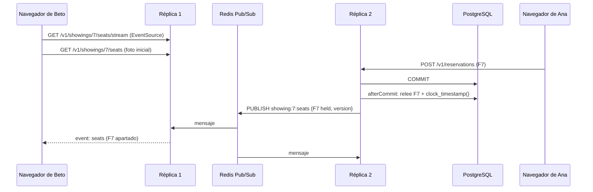

**Eventos.**

```text
retry: 3000

event: seats
data: {"version":"2026-10-10T19:00:00.012345Z","seats":[{"label":"F7","status":"held","held_until":"2026-10-10T19:00:30.004Z"}]}

event: reservation
data: {"reservation_id":"01928c41-…","type":"grace","expires_at":"2026-10-10T19:04:12.004Z"}

event: resync
data: {}

: ping
```

- `seats`, por el canal `showing:{id}:seats`: el estado efectivo de los asientos que cambiaron. Público: nunca lleva `reservation_id` ni el usuario.
- `reservation`, por el canal `user:{id}:reservations`: solo al dueño, por las conexiones de su sesión (`type` = `grace`, `expired`, `paid`). Así la prórroga llega a la pantalla de Ana sin que Beto sepa de quién es el asiento.
- `resync`: "perdí mensajes, vuelve a pedir la foto". Lo manda una réplica cuando se reconecta a Redis, porque Pub/Sub entrega como máximo una vez y lo publicado mientras estaba desconectada se perdió.
- `: ping` cada 15 s: un comentario que mantiene viva la conexión a través de proxies que cortan lo que está en silencio.

**El orden, sin un contador central.** Después del commit, quien hizo el cambio relee esos asientos con la consulta de 5.7 y les pone `version = clock_timestamp()` de PostgreSQL, y eso es lo que publica. El navegador guarda la versión de cada asiento y descarta un evento con una versión menor o igual. Funciona porque la relectura ocurre después del commit: una lectura posterior en el reloj de la base ve todos los commits anteriores, así que la versión más alta siempre tiene el estado más nuevo, aunque los mensajes lleguen desordenados. Se descartó un contador por función (`showings.seat_version + 1` en cada transacción) porque esa fila se volvería un lock que serializa todas las reservas de la función.

**El navegador**, en este orden: abre el `EventSource` y guarda en un buffer lo que llegue; pide la foto (`GET …/seats`, que también trae `version`); aplica la foto y después el buffer, asiento por asiento, con la regla de la versión. Ante `resync` o una reconexión (`EventSource` dispara `open` de nuevo), vuelve a pedir la foto.

**Lado del servidor** (Spring MVC):

- `SseEmitter` por conexión, registrado en `StreamRegistry` (un mapa concurrente de función a emisores, y de usuario a emisores). Se quita en `onCompletion`, `onTimeout` y `onError`. Timeout de 30 min: el navegador se reconecta solo.
- Hilos virtuales (`spring.threads.virtual.enabled: true`, Java 25): una conexión abierta no ocupa un hilo de plataforma.
- **Ninguna conexión SSE retiene una conexión de base.** El stream solo escribe lo que llega de Redis; la foto inicial es otra request. Si un stream tomara una conexión de PgBouncer, 20 espectadores agotarían el pool.
- Límites: 3 streams por usuario y 2 000 por réplica; por encima, `503` con `Retry-After`. Son parámetros de diseño, no mediciones: la guía pide medir cuántos aguanta una réplica.
- Autenticación con la cookie de sesión (`EventSource` la manda en el mismo origen). Es un `GET` sin efectos, así que no lleva token CSRF.
- Nginx delante: `proxy_buffering off`, `proxy_http_version 1.1`, `proxy_set_header Connection ""` y `proxy_read_timeout 1h` en esa ruta, o la cabecera `X-Accel-Buffering: no` desde la aplicación. Sin eso, Nginx junta los eventos en su buffer y llegan tarde y de a varios.

**Qué publica cada cambio en V2:** reservar, pasar al checkout, la prórroga (solo `reservation`), vender, cancelar y cada liberación del barrido. En V3 hay una diferencia que la guía A28 muestra: el vencimiento no escribe nada (6.3), así que no hay evento; el navegador pinta libre el asiento cuando pasa su `held_until`, con el desfase de reloj corregido, y la base sigue siendo la que decide.

---

# PARTE V3 — La alternativa recomendada

## 6. V3: claims temporales en la base + autorizar y capturar

### 6.1 La idea

V2 funciona, pero su corrección depende de que el código haga bien tres cosas: la regla de disponibilidad (`held` vencido sí, `checkout` vencido no), la toma perezosa y el barrido que cancela antes de liberar. Un bug en cualquiera vende un asiento dos veces. V3 cambia dos cosas:

1. **El apartado es un rango de tiempo y la base prohíbe que se pisen.** Cada hold, checkout o venta es una fila `seat_claims` con `active_during tstzrange`, y una **exclusion constraint** garantiza que dos claims del mismo asiento nunca se solapen en el tiempo. Un hold de 30 s es `[19:00:00, 19:00:30)`; al vencer no hay que cambiar nada: el rango simplemente quedó en el pasado y otro claim que empiece después no lo pisa. Una venta es `[t, infinity)`. **El vencimiento deja de ser código y pasa a ser dato.**
2. **El dinero se retiene, no se cobra, hasta tener el asiento.** El PaymentIntent se crea con `capture_method=manual`: el pago del cliente solo **autoriza** el monto. El servidor intenta convertir el claim en venta y **solo si lo logra captura**. Si el asiento ya no está, cancela la autorización y el banco libera la retención. Nunca hay que reembolsar, y el vencimiento puede ser automático aunque haya un pago en vuelo.

Las dos mitades se necesitan: sin la captura manual, un checkout que vence solo dejaría pasar un pago tardío por un asiento ya entregado a otro (el problema que V2 resuelve con el barrido).

### 6.2 Base de datos

`showings` y `reservations` quedan como en V2 (con `status` y `expires_at` solo para la interfaz y las métricas). `seats` pierde el estado: pasa a ser el catálogo de asientos. La verdad está en `seat_claims`.

```sql
CREATE EXTENSION IF NOT EXISTS btree_gist;   -- igualdad sobre bigint dentro de un índice GiST

CREATE TABLE seats (
  id          bigint GENERATED ALWAYS AS IDENTITY PRIMARY KEY,
  showing_id  bigint NOT NULL REFERENCES showings (id),
  label       text   NOT NULL,
  UNIQUE (showing_id, label)
);

CREATE TABLE seat_claims (
  id              uuid        PRIMARY KEY DEFAULT uuidv7(),
  seat_id         bigint      NOT NULL REFERENCES seats (id),
  reservation_id  uuid        NOT NULL REFERENCES reservations (id),
  kind            text        NOT NULL CHECK (kind IN ('hold', 'checkout', 'sold', 'void')),
  active_during   tstzrange   NOT NULL,
  ticket_code     text        UNIQUE,
  created_at      timestamptz NOT NULL DEFAULT now(),
  CHECK ((kind = 'sold') = (ticket_code IS NOT NULL)),
  CHECK (kind <> 'sold' OR upper_inf(active_during)),
  -- El invariante 2, escrito en la base: dos claims del mismo asiento nunca se solapan.
  CONSTRAINT one_claim_per_seat_at_a_time
    EXCLUDE USING gist (seat_id WITH =, active_during WITH &&)
);
CREATE INDEX seat_claims_reservation ON seat_claims (reservation_id);
```

PostgreSQL 18 tiene la misma regla con sintaxis de clave temporal, `UNIQUE (seat_id, active_during WITHOUT OVERLAPS)`, que se implementa como esta exclusion constraint *(Documentado)*. Se usa `EXCLUDE` porque `WITHOUT OVERLAPS` **no admite rangos vacíos**, y liberar un claim en la misma transacción que lo creó (`tstzrange(lower, now())` con `lower = now()`) produce uno.

Mapa de asientos (el estado es una consulta, no una columna):

```sql
SELECT s.label,
       COALESCE(c.kind, 'available')                             AS status,
       CASE WHEN NOT upper_inf(c.active_during) THEN upper(c.active_during) END AS held_until,
       now()                                                     AS server_time
FROM seats s
LEFT JOIN seat_claims c ON c.seat_id = s.id AND c.active_during @> now()
WHERE s.showing_id = $1
ORDER BY s.id;
```

El índice GiST de la constraint sirve también para este `@>`.

### 6.3 Las transiciones en SQL

**Reservar** (una transacción, como V2):

```sql
INSERT INTO seat_claims (seat_id, reservation_id, kind, active_during)
SELECT s.id, $res, 'hold', tstzrange(now(), now() + $reserve_ttl::interval)
FROM seats s
WHERE s.showing_id = $showing AND s.label = ANY($labels)
ORDER BY s.id;
-- filas < labels: 400
-- 23P01 exclusion_violation: algún asiento tiene un claim vigente → ROLLBACK, 409
```

Antes del `INSERT` se conserva el paso 4 de V2 (vencer la reserva propia que siga `held` con `expires_at` pasado), porque el índice único `one_active_reservation` sigue existiendo. Fuera de eso, no hay `SELECT … FOR UPDATE`, ni regla de disponibilidad, ni toma perezosa. Si dos transacciones insertan claims solapados del mismo asiento, la segunda espera a que la primera termine y falla con `23P01` si la primera confirmó. Insertar en orden de `seat_id` evita el deadlock entre dos reservas de varios asientos que se cruzan (A pide F7 y F8, B pide F8 y F7). Para saber qué asiento chocó y responder `409` con detalle, después del `ROLLBACK` se consulta el mapa de esos asientos.

**Pasar al checkout:**

```sql
UPDATE seat_claims
SET kind = 'checkout',
    active_during = tstzrange(lower(active_during), now() + $checkout_ttl::interval)
WHERE reservation_id = $res AND kind = 'hold' AND upper(active_during) > now();
-- filas <> seat_count: el hold venció → 410
```

Si el hold venció y otro usuario ya tomó el asiento, el rango extendido se solaparía con el claim del otro y la constraint lo rechaza (`23P01` → `410`). Si el hold venció y nadie lo tomó, el `WHERE upper(…) > now()` lo deja fuera y también es `410`: vencido es vencido, aunque esté libre. El usuario vuelve a reservar.

**Vender** (después de que Stripe autorizó):

```sql
UPDATE seat_claims
SET kind = 'sold',
    active_during = tstzrange(now(), 'infinity'),
    ticket_code = $code
WHERE reservation_id = $res AND kind = 'checkout' AND id = $claim_id;   -- uno por asiento, cada uno con su código
```

El rango nuevo empieza en `now()`, no en el `lower` original. Así funciona en los dos casos:

- El checkout sigue vigente: el rango nuevo se solapa solo con la propia fila (que se está reemplazando), y la venta pasa.
- El checkout venció hace un rato: si nadie tomó el asiento, `[now(), infinity)` no choca con nada y la venta pasa (el pago tardío se respeta). Si otro usuario lo tiene, choca con su claim, la constraint da `23P01` y se cancela la autorización.

Empezar en el `lower` original sería un error: chocaría con claims de otros que empezaron y terminaron en el intervalo (alguien lo apartó 30 s y lo abandonó), aunque el asiento hoy esté libre.

**Liberar** (cancelar la reserva, o compensar una captura que falló de forma definitiva):

```sql
UPDATE seat_claims
SET kind = 'void',
    ticket_code = NULL,
    active_during = tstzrange(lower(active_during), greatest(lower(active_during), now()))
WHERE reservation_id = $res AND kind <> 'void';
```

`void` existe para poder liberar también un claim `sold` (la compensación de 6.4) sin romper los `CHECK`: un claim anulado tiene el rango cerrado en el pasado y no bloquea a nadie, pero queda como historia.

### 6.4 El flujo con autorizar y capturar

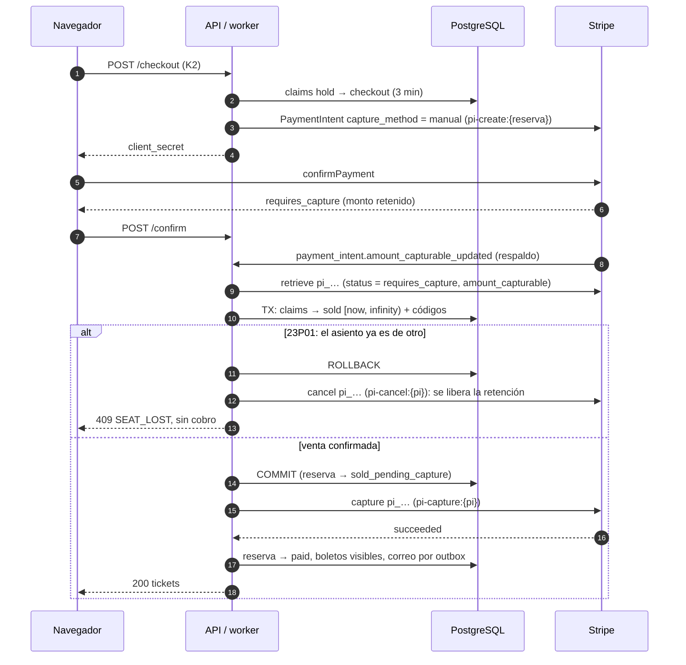

- **Cuándo se ven los boletos:** después de la captura, no después de la venta. Así se cumple el invariante 3 (ningún boleto sin dinero). Entre la venta y la captura, el asiento ya es del usuario y nadie más puede tomarlo.
- **Si la captura falla por la red:** la reserva queda en `sold_pending_capture` y el worker reintenta con `pi-capture:{pi}` (idempotente). Una autorización de tarjeta en línea iniciada por el cliente vale 7 días en Visa, Mastercard, American Express y Discover *(Documentado)*: sobra tiempo para reintentar.
- **Si la captura falla de forma definitiva** (la autorización se canceló o venció): compensación. Liberar los claims (6.3), reserva → `failed`, aviso al usuario. Es una saga de dos pasos (M27 27.11) en la que la compensación de "vender" es "liberar".
- **Métodos de pago:** la captura manual solo existe en algunos (tarjetas sí; ACH e iDEAL no) *(Documentado)*. V3 queda en `payment_method_types=["card"]`, como V2.
- **Lo que ve el cliente:** algunos bancos muestran la retención como un cargo hasta que se cancela; si se pierde el asiento, la pantalla dice "no se te cobró; tu banco liberará la retención". Stripe advierte que los estados de cuenta no siempre distinguen autorización de captura *(Documentado)*.

- **Qué ve el cliente con `SEAT_LOST`:** "Ese asiento ya no estaba disponible cuando tu banco autorizó el pago. No se te cobró; tu banco liberará la retención en unos días." Botón "Volver al mapa". Es la versión V3 del "Se acabó el tiempo" de V2, y el navegador la maneja con la misma tabla de 5.12 (el `GET` de la reserva devuelve `seat_lost`).

Estados de la reserva en V3: `held → checkout → sold_pending_capture → paid`, más `expired`, `canceled`, `seat_lost` y `failed`. Cambia el `CHECK` de `reservations.status` respecto de V2; `grace_used` se conserva.

### 6.5 Qué hace el barrido en V3

Ya no lo necesita la corrección: un claim vencido no bloquea a nadie. El barrido (cada 5 s) solo ordena y da la prórroga:

- **Prórroga de 3D Secure, por adelantado.** En V2 la prórroga se da al vencer, porque un `checkout` vencido no se puede tomar. En V3 sí: en cuanto termina el rango, otro usuario puede insertar su claim. Por eso el barrido mira hacia adelante: reservas `checkout` con `NOT grace_used` y `expires_at` en los próximos 10 s; si el PaymentIntent está en `requires_action`, extiende el rango mientras sigue vigente:

  ```sql
  UPDATE seat_claims
  SET active_during = tstzrange(lower(active_during), upper(active_during) + $grace::interval)
  WHERE reservation_id = $res AND kind = 'checkout' AND upper(active_during) > now();
  ```

  Extender un rango vigente nunca choca: todo claim de otro usuario sobre ese asiento tendría que empezar en su propio `now()`, que es anterior al `upper` actual, y la constraint lo habría rechazado. Si el barrido llega tarde (estuvo caído) y el rango ya venció, no hay prórroga, pero tampoco hay daño: un pago autorizado después todavía se vende si nadie tomó el asiento, y si alguien lo tomó termina en `SEAT_LOST` sin cobro (6.3, 6.4).
- Reservas `held` o `checkout` vencidas → `expired` (para la interfaz y las métricas).
- Reservas `checkout` vencidas con PaymentIntent sin confirmar → cancelarlo, para que el cliente no pueda autorizar después un pago que probablemente termine en `seat_lost`.
- Reservas `sold_pending_capture` con más de 1 min → reintentar la captura.

Si el barrido se cae una hora, nadie compra un asiento dos veces y nadie paga sin asiento. En V2, una hora sin barrido deja todos los checkouts vencidos apartados.

### 6.6 Carreras de V3

| # | Carrera | Resultado | Mecanismo |
|---|---|---|---|
| 1 | Dos reservas de F7 a la vez | Una confirma; la otra espera y recibe `23P01` → `409` | Exclusion constraint |
| 2 | Reserva de F7 un instante después de que venció el hold de otro | Pasa sin tocar la fila vieja | Rangos que no se solapan |
| 3 | A pide F7+F8, B pide F8+F7 | Sin deadlock: ambos insertan en orden de `seat_id` | Orden de inserción |
| 4 | Pago autorizado después de vencer el checkout, asiento libre | Se vende `[now, ∞)` y se captura | Venta desde `now()` |
| 5 | Pago autorizado después de vencer, asiento de otro | `23P01`, se cancela la autorización, sin reembolso | Captura manual |
| 6 | Webhook y `/confirm` a la vez | Uno vende y captura; el otro ve la reserva más adelante en su máquina y devuelve el estado | `FOR UPDATE` de la reserva + transiciones que solo avanzan |
| 7 | Bug: el código olvida verificar el vencimiento en algún camino | La base sigue sin permitir dos claims solapados | La regla vive en la constraint |
| 8 | El banco pide 3D Secure a 5 s de vencer | El barrido extiende el rango 60 s antes de que venza | Prórroga por adelantado (6.5) |
| 9 | El barrido está caído y el 3D Secure termina después de vencer | Se vende si el asiento sigue libre; si no, `SEAT_LOST` y se cancela la retención | Venta desde `now()` + captura manual |

### 6.7 Comparación y recomendación

| Criterio | V2: locks pesimistas + barrido | V3: claims temporales + captura manual | Locks en Redis (`SET NX PX`) | Fila de espera virtual |
|---|---|---|---|---|
| Dónde vive la regla "un asiento, un dueño" | En el código (regla de disponibilidad) y en la forma de la tabla | En una constraint de la base | En Redis, con la venta final en la base | No la resuelve: limita cuántos entran |
| Vencimiento | Toma perezosa + barrido obligatorio | Automático (es un rango) | TTL de Redis | No aplica |
| Pago tardío | No ocurre si el barrido cancela antes de liberar | Se vende si el asiento está libre; si no, se cancela la retención | Hay que resolverlo aparte | No aplica |
| Reembolsos por tiempo | Solo como red de seguridad | Nunca | Posibles | No aplica |
| Si el worker se cae | Los checkouts vencidos quedan apartados | Nada se rompe; solo se atrasan las métricas | Depende del diseño | No aplica |
| Riesgo propio | Un bug en la regla de disponibilidad vende dos veces | Retención visible en el estado de cuenta; solo tarjetas | Una conmutación de Redis con replicación asíncrona puede perder locks y dar el mismo asiento a dos | Más infraestructura y una cola que hay que hacer justa |
| Complejidad | Media | Media (GiST y `btree_gist`, captura en dos pasos) | Media, con dos fuentes de verdad | Alta |
| Cuándo conviene | Para aprender locks pesimistas y estados explícitos | **Recomendado** para producción con estos 100 asientos | Cuando la base no aguanta la carga de holds (decenas de miles de intentos por segundo) | Estrenos con muchísima más demanda que asientos; se suma delante de V3 |

**Recomendación:** V3. Mueve el invariante más caro (no vender dos veces) a la base, donde no depende de que cada camino del código lo recuerde, y la captura manual elimina el caso más feo de V2, el pago que llega cuando el asiento ya es de otro. V2 sigue en la guía porque es el pedido y porque enseña lo que V3 resuelve: el lector siente el problema del barrido antes de ver la constraint que lo elimina.

**Para una demanda mucho mayor** (un estreno con 50 000 personas para 100 asientos), ninguna de las dos alcanza sola: se pone una fila de espera virtual delante, que deja pasar a pocos usuarios a la vez, y detrás queda V3 sin cambios.

---

## 7. Observabilidad

| Métrica | Tipo | Para qué |
|---|---|---|
| `reservations_total{result="created\|seat_unavailable\|active_exists\|replayed"}` | counter | Cuánta contención hay por función |
| `seat_lock_conflicts_total{source="nowait\|exclusion"}` | counter | V2 contra V3 bajo la misma carga |
| `holds_expired_total{stage="held\|checkout"}` | counter | Cuántos abandonan en cada etapa |
| `checkout_to_paid_seconds` | histogram | Si 3 min alcanzan: un p95 cerca de 180 s dice que no |
| `stripe_requests_total{op, outcome}` y `stripe_request_seconds{op}` | counter, histogram | Errores y latencia por operación (`pi_create`, `pi_cancel`, `capture`) |
| `stripe_events_pending` y `stripe_events_lag_seconds` | gauge | La inbox se atrasa |
| `sweeper_checkout_blocked_total{pi_status}` | counter | V2: checkouts vencidos que no se pudieron liberar porque el pago estaba en curso |
| `payments_without_tickets` | gauge (consulta) | Debe ser 0; alerta crítica si no |
| `checkout_grace_total{outcome="paid\|expired"}` | counter | Cuántas prórrogas se dan y cuántas terminan en pago: si casi todas vencen, 60 s no alcanzan |
| `refunds_total{outcome="succeeded\|pending\|failed"}` y `orders_refund_requested` | counter, gauge | V1: reembolsos y cola pendiente |
| `sse_streams_open` y `sse_resync_total` | gauge, counter | Conexiones abiertas por réplica y cuántas veces hubo que pedir la foto de nuevo |

Consultas de invariantes que corren cada minuto y alertan si devuelven filas:

```sql
-- V2: un asiento vendido sin reserva pagada
SELECT s.id FROM seats s JOIN reservations r ON r.id = s.reservation_id
WHERE s.status = 'sold' AND r.status <> 'paid';

-- V2: una reserva pagada con menos asientos vendidos que los que compró
SELECT r.id FROM reservations r
LEFT JOIN seats s ON s.reservation_id = r.id AND s.status = 'sold'
WHERE r.status = 'paid'
GROUP BY r.id, r.seat_count HAVING count(s.id) <> r.seat_count;

-- V3: la constraint lo garantiza, pero la consulta documenta la regla
SELECT a.seat_id FROM seat_claims a JOIN seat_claims b
  ON a.seat_id = b.seat_id AND a.id < b.id AND a.active_during && b.active_during;
```

Logs estructurados con `request_id`, `user_id`, `reservation_id`, `payment_intent_id` y `idem_key` (el UUID no es sensible); nunca el `client_secret`.

---

## 8. Cómo se comprueba (para la sección "Cómo comprobarlo" de las guías)

Claude escribe estas pruebas; las corre el lector. La guía dice qué comando correr y qué tiene que aparecer, sin cifras inventadas.

### 8.1 Pruebas sin Stripe (`FakePaymentGateway`, Testcontainers con PostgreSQL 18)

| Prueba | Qué tiene que pasar |
|---|---|
| Misma `Idempotency-Key` dos veces | Una orden o reserva; la segunda respuesta trae `Idempotent-Replayed: true` y el mismo body |
| Misma clave, otro body | `422` |
| Misma clave, dos hilos a la vez | Una ejecución; la otra repite o recibe `409` |
| 200 hilos reservan F7 a la vez (V2 y V3) | Exactamente un `201`, 199 `409`; la consulta de invariantes devuelve 0 filas |
| 100 usuarios reservan 100 asientos distintos, más 50 que piden asientos al azar | Ningún asiento con dos dueños; la suma de `201` y asientos libres da 100 |
| Hold de 2 s (TTL de prueba): reservar, esperar 3 s, otro usuario reserva | El segundo obtiene el asiento; la primera reserva queda `expired` |
| Checkout de 5 s con el fake en `processing` al vencer (V2) | El barrido no libera; al pasar el fake a `succeeded`, `finalize` vende |
| Pago autorizado después de que otro tomó el asiento (V3) | El fake recibe `cancel`, nunca `capture`; la reserva queda `seat_lost` |
| La API "muere" entre crear el PaymentIntent y TX3 (excepción inyectada) | El reintento con la misma clave pide al fake la misma clave `pi-create:{reserva}` y termina bien |
| `finalize` llamado 10 veces en paralelo | Los mismos códigos de boleto en las 10 respuestas |
| V2: checkout de 5 s, el fake en `requires_action` al vencer, prórroga de 3 s | La reserva sigue `checkout` con `grace_used = true` y `expires_at` 3 s más tarde; si el fake pasa a `succeeded`, se vende; si sigue en `requires_action`, el fake recibe `cancel` y los asientos se liberan |
| V2: el fake devuelve error en `cancel` y `succeeded` al releer | No se libera; `finalize` vende |
| V1: reembolso con la misma clave dos veces | Un solo `createRefund` en el fake; la segunda respuesta repite el `202` |
| V1: reembolso a los 8 días (reloj de la prueba con `paid_at` en el pasado) | `409 REFUND_NOT_ALLOWED` |
| V1: el fake devuelve `charge_disputed` | `refund_failed` con `last_error`, sin reintentos |
| SSE: dos clientes en la función, uno reserva | El otro recibe `event: seats` con el asiento apartado; un evento con versión vieja enviado a mano se descarta |

### 8.2 Pruebas con Stripe en sandbox

| Comando o acción | Qué tiene que aparecer |
|---|---|
| `stripe listen --forward-to localhost:8080/webhooks/stripe` + pagar con `4242 4242 4242 4242` | En la CLI, `[200 POST]` para `payment_intent.succeeded`; en la base, la reserva `paid` y los códigos |
| Pagar con `4000 0025 0000 3155` | El desafío de 3D Secure en el Payment Element; después, `paid` |
| Pagar con `4000 0000 0000 9995` | `402` en `/confirm` con `insufficient_funds`; la reserva sigue `checkout` |
| No pagar y esperar 3 min | En el Dashboard, el PaymentIntent `Canceled`; en el mapa, los asientos libres |
| `stripe events resend evt_…` | El evento aparece una vez en `stripe_events`; nada se procesa dos veces |
| `curl` a `/webhooks/stripe` con una firma inventada | `400`; ninguna fila nueva |
| `curl` con una firma válida capturada hace 10 min (repetición) | `400` por la tolerancia de 300 s |
| V3: pagar y mirar el Dashboard antes de la captura | El pago aparece `Uncaptured` y después `Succeeded` |
| V2 con el perfil de prueba (checkout de 20 s, prórroga de 15 s): pagar con `4000 0027 6000 3184` y dejar abierto el desafío hasta que venza el checkout | En la pantalla, el aviso de la prórroga; si se completa el desafío dentro de los 15 s, `paid`; si no, "Se acabó el tiempo" y el PaymentIntent `Canceled` en el Dashboard |
| V1: pagar con `4000 0000 0000 7726` y pedir el reembolso | La orden pasa por `refund_requested` y `refund_pending`; después de `refund.updated`, `refunded` |
| V1: pagar con `4000 0000 0000 5126` y pedir el reembolso | Primero `refunded`; después de `refund.failed`, `refund_failed` y la alerta |
| `curl -N` a `/v1/showings/7/seats/stream` con la cookie de sesión y reservar desde otra terminal | El `event: seats` aparece en el `curl` sin esperar; cada 15 s, `: ping` |

### 8.3 Fallas provocadas

- Apagar PostgreSQL durante una reserva: `503`, nada a medias; al volver, el reintento con la misma clave funciona.
- Bloquear la salida a `api.stripe.com` (regla de nftables, M32) durante el checkout: `503`, clave en `started`; al quitar la regla, el reintento recibe el mismo PaymentIntent.
- Detener el worker 5 min (V2 contra V3): en V2, los checkouts vencidos quedan apartados en el mapa; en V3, se pueden reservar.
- Webhook caído 10 min: `/confirm` igual entrega boletos; al volver, la inbox se vacía sin duplicados.
- Reiniciar Redis con dos navegadores abiertos: cada réplica manda `resync` al reconectarse y los mapas vuelven a coincidir con la base.
- Quitar `proxy_buffering off` de Nginx: los eventos llegan tarde y de a varios; volver a ponerlo.

---

## 9. Decisiones tomadas (2026-10-10)

1. **Guías:** tres guías separadas, una tras otra: A15 (V1), A27 (V2) y A28 (V3). Sección 0.2.
2. **3D Secure al borde del plazo:** una prórroga única de 60 s, solo si el PaymentIntent está en `requires_action`, con el manejo del error en el navegador. Secciones 5.12 y 6.5.
3. **Mapa en vivo:** SSE con Redis Pub/Sub. Sección 5.15.
4. **Reembolsos:** solo en la versión ligera, V1: reembolso total pedido por el cliente durante 7 días. Los boletos de V2 y V3 no se reembolsan desde la aplicación. Secciones 4.6 y 5.6.
5. **Moneda:** USD, fijada con `CHECK (currency = 'usd')`. Sección 2.7.

---

## 10. Fuentes (verificadas el 2026-10-10)

| Dato | Fuente |
|---|---|
| Checkout Session `expires_at` entre 30 min y 24 h; `client_reference_id` hasta 200 caracteres | https://docs.stripe.com/api/checkout/sessions/create |
| Idempotency keys: hasta 255 caracteres, al menos 24 h, compara parámetros, guarda respuestas desde que empieza la ejecución (incluidos 500), no guarda validaciones fallidas ni conflictos concurrentes | https://docs.stripe.com/api/idempotent_requests |
| `Stripe-Signature` con `t=` y `v1=`, HMAC-SHA256 sobre `{t}.{body}`, ignorar esquemas que no son `v1`, tolerancia de 5 min por defecto (nunca 0), comparación en tiempo constante, body crudo | https://docs.stripe.com/webhooks |
| Reintentos hasta 3 días en live, sin orden garantizado, duplicados, 2xx rápido, procesamiento asíncrono, IPs de Stripe, rotación del secreto con 24 h de solapamiento | https://docs.stripe.com/webhooks, https://docs.stripe.com/events/manage-webhook-endpoints |
| Snapshot contra thin; `snapshot_api_version` fijo al crear el destino; thin para v1 en vista previa privada | https://docs.stripe.com/events/set-up-events, https://docs.stripe.com/upgrades |
| Versión `2026-09-30.endive`; en Java la fija el SDK | https://docs.stripe.com/upgrades |
| stripe-java 34.0.0 estable (2026-10-01) | https://github.com/stripe/stripe-java/releases |
| Claves restringidas `rk_`, permisos None/Read/Write, una por servicio | https://docs.stripe.com/keys/restricted-api-keys |
| `capture_method=manual`, `requires_capture`, `payment_intent.amount_capturable_updated`, autorización de 7 días (CIT en línea), qué métodos lo soportan, captura parcial | https://docs.stripe.com/payments/place-a-hold-on-a-payment-method |
| Entrega en Checkout: `checkout.session.completed` y `async_payment_succeeded`, `fulfill` idempotente y concurrente, disparar también desde la página de destino, espera de hasta 10 s, `{CHECKOUT_SESSION_ID}` | https://docs.stripe.com/checkout/fulfillment |
| Tarjetas de prueba, incluidas las de reembolso asíncrono (`…7726`, `…5126`) y las de 3D Secure (`…3155`, `…3184`) | https://docs.stripe.com/testing |
| Estados en los que se puede cancelar un PaymentIntent; `processing` solo con algunos débitos bancarios; el PaymentIntent de una Checkout Session solo se cancela en `requires_capture` | https://docs.stripe.com/api/payment_intents/cancel, https://docs.stripe.com/refunds |
| `requires_action` durante 3D Secure; un rechazo devuelve el PaymentIntent a `requires_payment_method`; Stripe recomienda Checkout Sessions con `ui_mode: "elements"` | https://docs.stripe.com/payments/paymentintents/lifecycle |
| Reembolsos: al método original, comisiones no devueltas, pendientes por saldo insuficiente con tarjeta, reversión, 5 a 10 días hábiles, `refund.failed` y qué hacer, eventos | https://docs.stripe.com/refunds |
| Códigos `payment_intent_unexpected_state`, `payment_intent_authentication_failure`, `lock_timeout`, `charge_already_refunded`, `charge_disputed`, `amount_too_small`, `idempotency_key_in_use` | https://docs.stripe.com/error-codes |
| Cobro mínimo de 0.50 USD | https://docs.stripe.com/currencies |
| Vencer una Checkout Session a mano (`POST /v1/checkout/sessions/{id}/expire`) | https://docs.stripe.com/api/checkout/sessions/expire |
| PCI y elegibilidad de SAQ con Checkout y Elements (verificar al escribir la guía) | https://docs.stripe.com/security/guide |
| `WITHOUT OVERLAPS` equivale a `EXCLUDE USING GIST`, necesita `btree_gist` para columnas escalares, no admite rangos vacíos | https://www.postgresql.org/docs/18/sql-createtable.html |
| Idempotency keys con fases atómicas (`recovery_point`) | https://brandur.org/idempotency-keys (Diseño de referencia) |

Por verificar al escribir cada guía: la firma exacta de `StripeClient` en stripe-java 34.0.0 (`client.v1().paymentIntents()…` y `RequestOptions.builder().setIdempotencyKey(…)`), los nombres actuales de los permisos de las claves restringidas en el Dashboard, y en sandbox el código que devuelve Stripe.js al confirmar un PaymentIntent cancelado (5.12).
